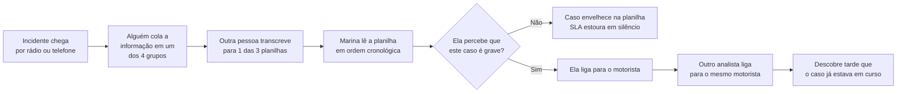
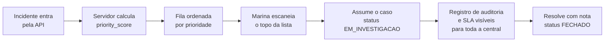

# Visão de Produto

Este documento define para quem o Logos existe, qual problema ele resolve, como
o trabalho da analista muda com ele e quais números provam que a mudança
aconteceu.

## 1. Contexto de negócio

Uma transportadora opera **5.000 caminhões em rota** e mantém um Centro de
Controle com analistas dedicados a responder incidentes: acidentes, bloqueios
de pista, falhas mecânicas e condições climáticas atípicas.

Cada incidente tem dois custos que crescem com o tempo: o caminhão parado
(carga atrasada, cliente notificado, receita perdida) e a multa contratual por
SLA estourado. O que determina qual dos dois acontece — e com que frequência —
não é a capacidade de resolver o incidente, e sim **a velocidade com que ele é
percebido e priorizado corretamente**.

Hoje essa percepção depende de quatro grupos de WhatsApp e três planilhas
compartilhadas. Não existe uma fonte única da verdade, não existe priorização
automática e não existe registro confiável de quem fez o quê.

## 2. A persona

> **Marina, 31 anos — Analista de Central de Resposta a Incidentes**
>
> Trabalha no Centro de Controle da transportadora. Monitora 5.000 caminhões em
> rota em doze monitores, em uma sala com a TV ligada no telejornal. É
> interrompida a cada aproximadamente dois minutos. **Não lê: escaneia.**
> Toma decisões de dezenas de milhares de reais em segundos — e depois precisa
> justificar cada uma delas.

Três características da Marina determinam todo o design do produto:

| Característica                          | Consequência de projeto                                                                                                                              |
| --------------------------------------- | ---------------------------------------------------------------------------------------------------------------------------------------------------- |
| **Escaneia, não lê.**                   | Informação em camadas: o essencial (categoria, criticidade, tempo em aberto) é legível em um relance; o detalhe fica sob demanda.                    |
| **É interrompida a cada dois minutos.** | O estado da aplicação precisa sobreviver à interrupção: nada de perder filtro, scroll ou rascunho. A lista nunca reordena sozinha embaixo do cursor. |
| **Precisa justificar depois.**          | Toda mudança gera registro de auditoria. `FECHADO` e `INCONCLUSIVO` exigem nota de resolução.                                                        |

### Persona secundária

**Coordenador de operações.** Não opera a fila; consome os indicadores. Precisa
saber quantos casos estão abertos, quantos estão com SLA vencendo e onde estão
concentrados. É o consumidor dos KPIs do topo da tela e, no roadmap, dos
relatórios de SLA por período.

## 3. Jornada: hoje vs. com o Logos

### 3.1 Jornada atual

O ponto de falha está no losango: **a decisão de prioridade depende de a Marina
ter visto a mensagem certa**, no grupo certo, no momento certo. A planilha
registra o que aconteceu, mas não ajuda a decidir o que fazer primeiro.

### 3.2 Jornada com o Logos

Diferenças estruturais: a priorização **não depende de leitura atenta**, o
status **é visível para todos** (o que elimina a ligação duplicada) e o
encerramento **deixa rastro** (o que resolve a cobrança posterior).

## 4. Dores e o que o Logos faz a respeito

| Dor                                                                  | Impacto operacional                                        | O que o Logos resolve                                                       |
| -------------------------------------------------------------------- | ---------------------------------------------------------- | --------------------------------------------------------------------------- |
| Informação espalhada em 4 grupos de WhatsApp e 3 planilhas           | A analista não sabe se o incidente já foi visto por alguém | Fonte única da verdade, com status visível para toda a central              |
| Sem priorização: o pneu furado aparece junto do acidente com vítimas | Ordem de atendimento errada e prejuízo direto              | _Priority score_ determinístico ordena a fila automaticamente               |
| Dois analistas ligam para o mesmo motorista                          | Retrabalho e irritação do cliente                          | Status compartilhado + lock otimista com aviso explícito de conflito        |
| O prazo de SLA é perdido sem que ninguém perceba                     | Multa contratual                                           | Timer regressivo com alerta visual progressivo e pressão de SLA no score    |
| O sistema "trava" e ela não sabe se salvou                           | Ela clica três vezes e cria registros duplicados           | Feedback de estado explícito + `Idempotency-Key` nas mutações               |
| Não há registro de quem decidiu o quê                                | Impossível justificar a decisão depois                     | Timeline de auditoria por incidente e nota de resolução obrigatória         |
| A lista se reordena sozinha durante o plantão                        | Clique no incidente errado, ação no caso errado            | Novos eventos alimentam um contador; a lista só reordena sob ação explícita |

## 5. Jobs-to-be-done

### JTBD 1 — Triagem em segundos

> _"Quando eu abro o Logos, quero saber em 3 segundos qual é o pior problema agora."_

O produto atende isso entregando, na primeira dobra, os KPIs por status, o
contador de SLA vencendo e a lista já ordenada por prioridade — não por data.

### JTBD 2 — Posse sem ambiguidade

> _"Quando eu assumo um caso, quero ter certeza de que ninguém mais vai falar com o mesmo motorista."_

O produto atende isso tornando o status e o analista responsável visíveis para
todos, e recusando sobrescrita silenciosa: se alguém mudou o caso antes, a
segunda tentativa falha com `409` e mostra o que mudou.

### JTBD 3 — Encerramento defensável

> _"Quando eu fecho um caso, quero registrar o porquê para não ser cobrada depois."_

O produto atende isso exigindo `resolution_notes` para `FECHADO` e
`INCONCLUSIVO`, e gravando cada transição na timeline de auditoria com autor e
horário.

## 6. Princípio central: gestão por exceção

> **A tela padrão já responde "o que está pegando fogo?". A analista age apenas
> no que foge da normalidade; tudo que é normal permanece visualmente silencioso.**

Esse princípio produz quatro corolários concretos:

1. **Ordenação padrão é prioridade, não data.** A ordem cronológica é uma opção
   de ordenação, nunca o padrão.
2. **Aging embutido no score.** Um incidente aberto há muito tempo sobe sozinho:
   o que era baixo vira alto se ninguém olhar. O teto do aging evita que todo
   caso vire `ALTA` e o sinal perca valor.
3. **Silêncio visual para o trivial.** `BAIXA` tem borda fina e cor discreta;
   `ALTA` ocupa espaço visual. A tela não gasta atenção com o que não exige ação.
4. **Densidade sob controle.** Modo _confortável_ (padrão) e _compacto_ (para
   monitoramento prolongado), com a escolha persistida.

O princípio também justifica uma decisão que parece contraintuitiva: **a lista
não deve reordenar sozinha**. Reordenar embaixo do cursor durante o plantão
causa clique no incidente errado, e o custo de um clique errado em missão
crítica é maior que o benefício de ver o item novo imediatamente. Por isso o
SSE alimenta um contador — _"3 novos incidentes"_ — e a atualização acontece
sob ação explícita da analista.

## 7. Métricas de sucesso

| Métrica                                    | Definição                                                                         | Meta                            | Como é verificada                                                                                  |
| ------------------------------------------ | --------------------------------------------------------------------------------- | ------------------------------- | -------------------------------------------------------------------------------------------------- |
| **TTT** — _time-to-triage_                 | Tempo entre o incidente entrar no sistema e a analista identificar sua prioridade | `< 5s`                          | Medição na interface com a lista de 120 incidentes do seed; instrumentação no roadmap.             |
| **TTA** — _time-to-acknowledge_            | Tempo entre a criação e a saída de `ABERTO`                                       | `-40%` frente ao processo atual | Timeline de auditoria (`created_at` → primeiro evento de transição).                               |
| **Taxa de colisão**                        | Sobrescritas silenciosas entre analistas                                          | `0`                             | Toda colisão vira `409` tratado e visível; o teste de concorrência comprova o comportamento.       |
| **Taxa de erro 5xx sob oscilação de rede** | Requisições que terminam em `500` durante instabilidade                           | `0`                             | Degradação explícita: cache _stale_, `503` com `Retry-After` e banner de aviso em vez de erro cru. |

### 7.1 Leitura das metas

**TTT e TTA medem o produto, não o código.** As duas primeiras metas só fazem
sentido se a ordenação padrão for a prioridade e se o score for explicável — a
analista precisa confiar na ordem para agir rápido.

**Taxa de colisão zero não significa zero conflitos.** Conflitos vão existir:
dois analistas vão agir sobre o mesmo caso. A meta é que **nenhum conflito seja
silencioso**. Um `409` mostrado na tela é o sistema funcionando; um `200` que
apaga a decisão do colega é o sistema falhando.

**Zero `5xx` não significa zero falhas.** Significa que falhas de
infraestrutura são traduzidas em respostas que a interface sabe interpretar
(`503` com `Retry-After`, cache servido com aviso de defasagem), em vez de
vazarem como erro interno não tratado.

## 8. O que o produto não é

Para evitar expectativa errada sobre o escopo:

- **Não é um sistema de telemetria.** Não rastreia posição dos caminhões em
  tempo real.
- **Não é um sistema de comunicação.** Não envia mensagens para motoristas; a
  conversa continua no rádio, e o Logos registra o resultado dela.
- **Não substitui o ERP.** Não trata frete, faturamento ou manutenção
  preventiva.
- **Não é multiusuário com autenticação real** nesta entrega. A autoria é
  simulada e o caminho de evolução está documentado no
  [README](../README.md#fora-de-escopo-e-roadmap).
