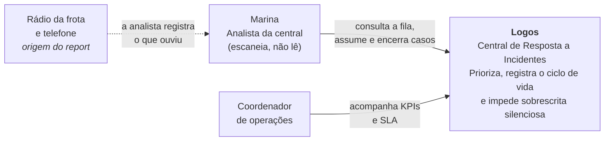
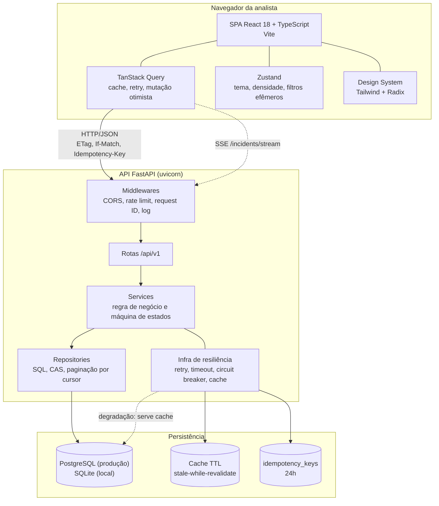
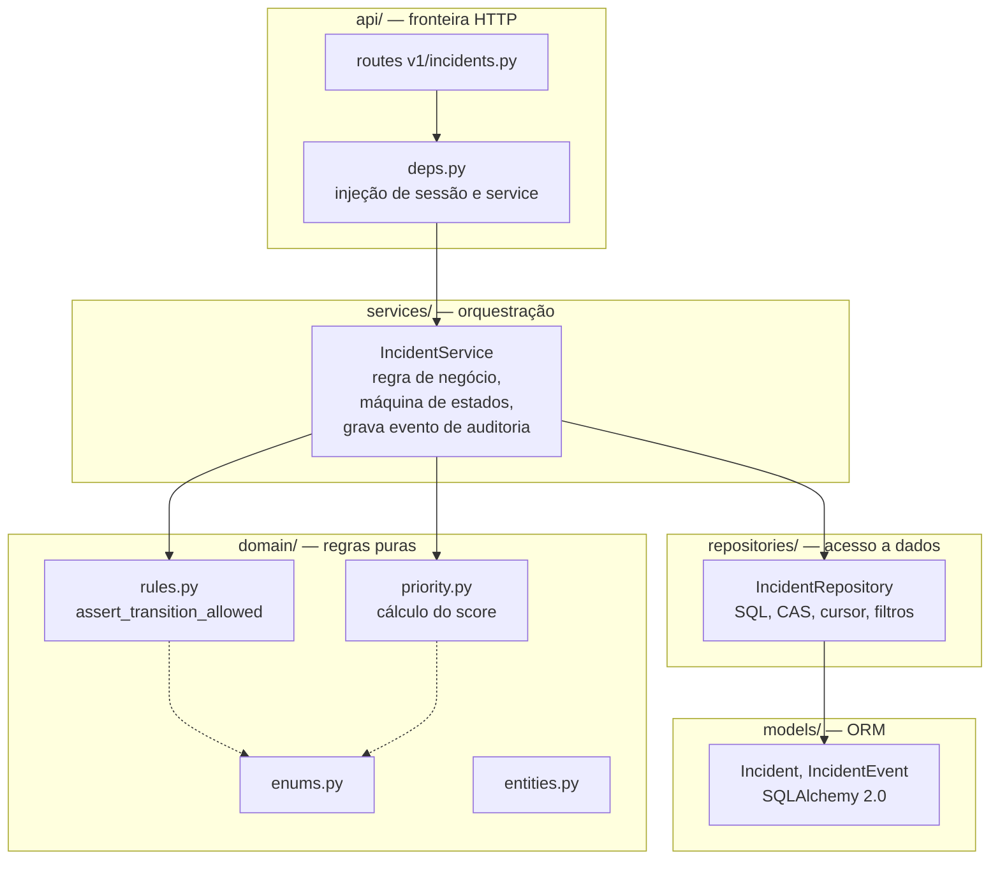
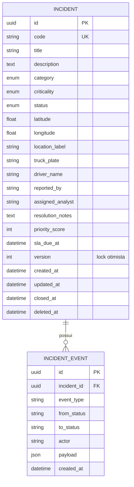
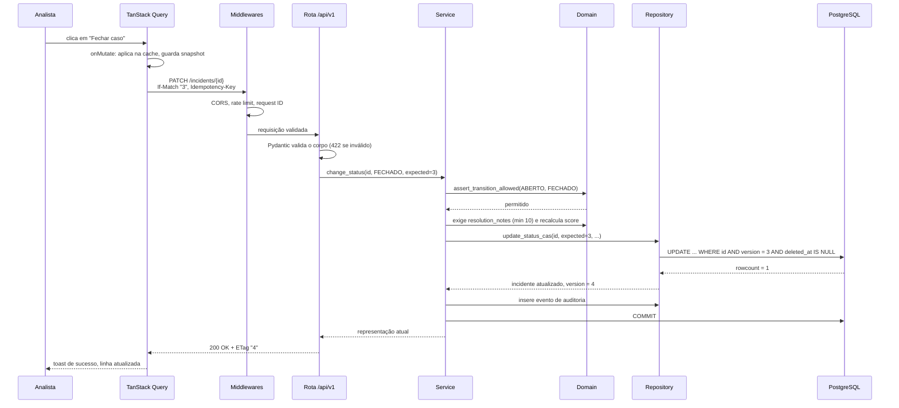
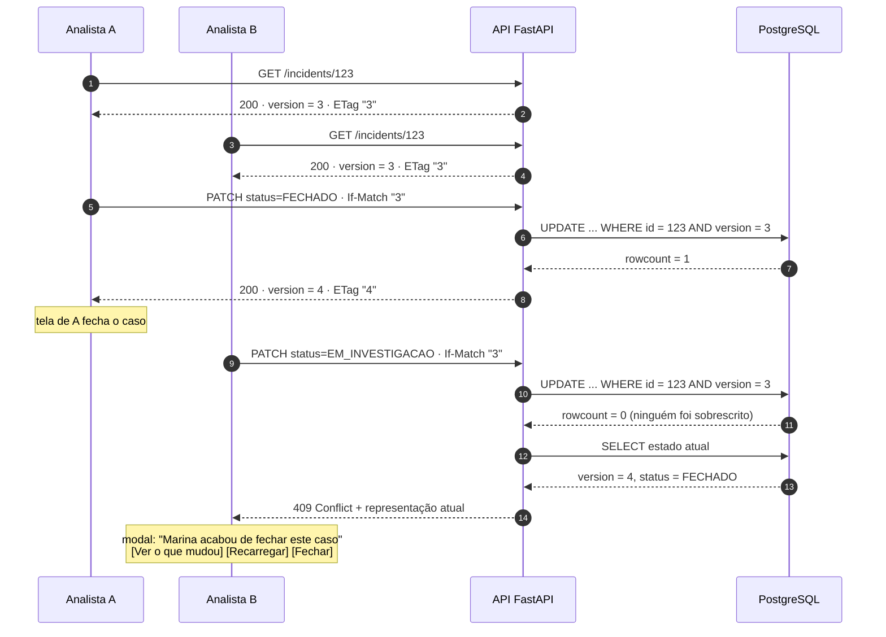

# Arquitetura

Este documento descreve a estrutura do sistema em três níveis de detalhe —
contexto, containers e camadas internas — e mostra o caminho que uma
requisição percorre desde o clique da analista até a resposta, incluindo o caso
de conflito.

## 1. Visão de contexto (C4 nível 1)



O Logos é um sistema único do ponto de vista de quem usa. Fora dele ficam o
rádio e o telefone (canal de entrada, humano) e, no roadmap, um provedor de
identidade (autoria real).

## 2. Visão de containers (C4 nível 2)



| Container | Responsabilidade | Não faz |
| --- | --- | --- |
| SPA React | Apresentar a fila priorizada, coletar a decisão da analista, manter o estado de UI explícito | Não calcula prioridade, não decide transição de status |
| API FastAPI | Validar entrada, aplicar regra de negócio, persistir, garantir integridade | Não renderiza, não conhece o formato da tela |
| PostgreSQL / SQLite | Persistir e garantir o compare-and-swap atômico | Não contém regra de negócio (nenhuma *trigger* com lógica de domínio) |
| Cache TTL | Servir resposta utilizável durante degradação | Não é fonte de verdade |

**Por que o front não calcula o priority score:** dois analistas precisam ver
exatamente a mesma ordem, e a ordenação precisa ser auditável e testável. Ver
[ADR 0013](adr/0013-priority-score-no-servidor.md).

## 3. Camadas internas do backend



### 3.1 A regra de dependência

```
api → services → { domain, repositories }
repositories → models
domain → (nada)
```

**O domínio não conhece HTTP nem ORM.** `app/domain/` contém apenas enums,
regras puras e funções de cálculo. Consequências práticas:

- `assert_transition_allowed(ABERTO, FECHADO)` é uma função pura: recebe dois
  enums, devolve nada ou levanta uma exceção de domínio. Não abre transação,
  não importa SQLAlchemy, não conhece `Request`.
- O cálculo do priority score é uma função determinística de quatro números.
  Isso o torna testável por faixa, sem banco, e explicável na interface.
- Trocar SQLite por PostgreSQL, ou FastAPI por outro framework, não exige
  alterar nenhuma linha em `domain/`.

### 3.2 Responsabilidade de cada camada

| Camada | Faz | Não faz |
| --- | --- | --- |
| `api/` | Deserializa, valida formato, chama o service, serializa a saída, mapeia exceção de domínio em *status code* | Não contém `if` de regra de negócio, não monta SQL |
| `services/` | Aplica a máquina de estados, recalcula o score, orquestra repositório, grava o evento de auditoria, decide o momento do `commit` | Não conhece `Request`, não monta query |
| `domain/` | Regras puras, enums, cálculo do score | Não conhece HTTP, ORM, sessão ou configuração |
| `repositories/` | Traduz operações de domínio em SQL, executa o CAS, monta cursor de paginação | Não decide se a transição é permitida |
| `models/` | Mapeamento objeto-relacional e índices | Não contém regra de negócio |

### 3.3 Módulos de infraestrutura

`app/infra/` reúne o que dá sustentação ao Pilar 2 e é ortogonal ao domínio:

| Módulo | Papel |
| --- | --- |
| `cache.py` | Cache TTL da listagem com *stale-while-revalidate*. |
| `retry.py` | Backoff exponencial com jitter, restrito a operações idempotentes e falhas de infraestrutura. |
| `circuit_breaker.py` | Abre após N falhas consecutivas e responde `503` com `Retry-After` em vez de enfileirar requisições condenadas. |
| `seed.py` | Gera os 120 incidentes realistas da demonstração. |

## 4. Modelo de dados



Os índices do modelo e a razão de cada um:

| Índice | Consulta que atende |
| --- | --- |
| `UNIQUE (code)` | Busca pelo código falado no rádio (`INC-2026-000123`). |
| `(status, criticality, priority_score DESC)` | Consulta principal da tela de triagem: filtro combinado mais ordenação por prioridade. |
| `(category, created_at DESC)` | Filtro por categoria com ordenação temporal. |
| `(deleted_at)` | Toda query filtra `deleted_at IS NULL` por causa do soft delete. |
| `(sla_due_at)` | Alerta de SLA vencendo. |
| `(assigned_analyst)` | Visão "meus casos". |
| `GIN` em `title`/`description` (PostgreSQL) | Busca textual; no SQLite cai para `LIKE`. |

## 5. Fluxo de uma requisição ponta a ponta



Caminhos de exceção do mesmo fluxo:

| Ponto de falha | Resultado | O que a interface faz |
| --- | --- | --- |
| Payload inválido no formato | `422` | Destaca o campo e explica a regra. |
| Transição proibida pela máquina de estados | `422 INVALID_STATUS_TRANSITION` | Marca a ação como indisponível (defesa em profundidade: o front já desabilita). |
| `FECHADO` sem `resolution_notes` | `422 RESOLUTION_NOTES_REQUIRED` | Abre o campo de nota com foco e contador de caracteres. |
| `version` divergente | `409 VERSION_CONFLICT` | Rollback da UI otimista e modal de conflito com o diff. |
| `If-Match` mal formado ou inexistente no histórico | `412 PRECONDITION_FAILED` | Recarrega o recurso e pede nova confirmação. |
| Chave de idempotência reusada com corpo diferente | `409 IDEMPOTENCY_KEY_REUSED` | Toast de erro fatal com "copiar detalhes técnicos". |
| Banco indisponível ou circuit breaker aberto | `503` + `Retry-After` | Mantém o cache na tela, banner de instabilidade, retry com backoff. |

## 6. Sequência do conflito de status



O detalhamento do mecanismo, o tratamento no frontend e a política de
idempotência estão em
[`04-concorrencia-e-resiliencia.md`](04-concorrencia-e-resiliencia.md).

## 7. Decisões de arquitetura

| ADR | Decisão | Alternativa descartada |
| --- | --- | --- |
| [0001](adr/0001-monorepo.md) | Monorepo `backend/` + `frontend/` | Dois repositórios |
| [0002](adr/0002-fastapi.md) | FastAPI sobre Python 3.12 | Flask, Django REST |
| [0003](adr/0003-postgres-e-sqlite.md) | SQLAlchemy 2.0 + Alembic; SQLite local e PostgreSQL em produção | JSON estruturado |
| [0004](adr/0004-react-vite.md) | React 18 + TypeScript + Vite | Next.js |
| [0005](adr/0005-tanstack-query.md) | TanStack Query para estado de servidor | Redux Toolkit, SWR |
| [0006](adr/0006-zustand.md) | Zustand para estado de UI | Context API puro |
| [0007](adr/0007-tailwind-shadcn.md) | Tailwind CSS + shadcn/ui (Radix) | MUI, Chakra |
| [0008](adr/0008-optimistic-locking.md) | Optimistic locking com `version` e `ETag` | Pessimistic lock (`SELECT FOR UPDATE`) |
| [0009](adr/0009-ruff-mypy.md) | Ruff + mypy no backend | flake8 + black + isort |
| [0010](adr/0010-cursor-pagination.md) | Paginação por cursor | Offset/limit |
| [0011](adr/0011-sse.md) | SSE para tempo real | WebSocket |
| [0012](adr/0012-render-vercel-neon.md) | Render + Vercel + Neon | Hugging Face Spaces, Replit |
| [0013](adr/0013-priority-score-no-servidor.md) | Priority score calculado no servidor | Ordenar no cliente |
| [0014](adr/0014-soft-delete.md) | Soft delete | Hard delete |

## 8. Decisões transversais

### 8.1 Defesa em profundidade

A validação acontece em três níveis independentes, e não em um só:

1. **Pydantic v2** valida formato e tipo na fronteira HTTP.
2. **Domain** valida semântica: transição permitida, nota obrigatória, faixa de coordenadas.
3. **Banco** garante integridade: `version` no `WHERE` do `UPDATE`, `UNIQUE` em `code`, `NOT NULL` onde couber.

Nenhum nível confia que o anterior já resolveu.

### 8.2 Contrato espelhado, não presumido

Os tipos do frontend (`features/incidents/types.ts`) espelham o contrato da API
e são validados em runtime com Zod. Uma resposta fora do contrato falha cedo,
na fronteira do cliente HTTP, em vez de virar erro obscuro no meio da
renderização.

### 8.3 Observabilidade como parte da arquitetura

Toda requisição recebe um `X-Request-Id` (aceito do cliente ou gerado no
servidor), presente no log estruturado e no envelope de erro. Isso permite
correlacionar o que a analista viu na tela com o que aconteceu no servidor —
sem isso, o tratamento de `409` e `503` fica impossível de depurar.
