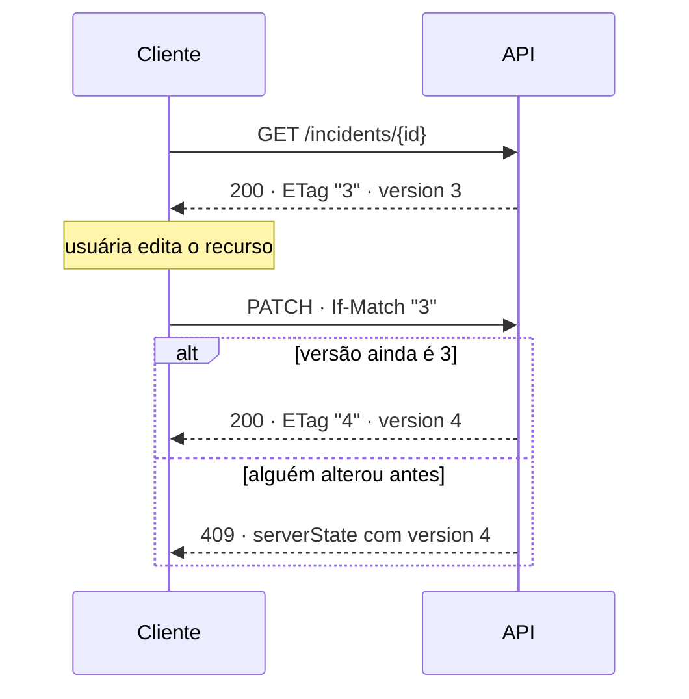

# Contrato da API

Referência completa dos endpoints, parâmetros, exemplos de payload, envelope de
erro e cabeçalhos HTTP da API v1 do Logos.

## 1. Convenções gerais

| Item                  | Definição                                                                |
| --------------------- | ------------------------------------------------------------------------ |
| Base URL              | `/api/v1` — ex.: `http://localhost:8000/api/v1`                          |
| Content-Type          | `application/json; charset=utf-8`                                        |
| Identificador público | `id` em UUID v4; `code` legível no formato `INC-AAAA-NNNNNN`             |
| Datas                 | ISO-8601 em UTC, com sufixo `Z` (`2026-02-11T12:31:12Z`)                 |
| Enumeração            | Valores em maiúsculas com underscore (`ACIDENTE_COM_VITIMAS`)            |
| Casing                | `snake_case` nos parâmetros de query; `camelCase` no corpo e na resposta |
| Documentação viva     | OpenAPI 3.1 em `/docs` (Swagger UI) e `/redoc` (ReDoc)                   |

## 2. Endpoints

| Método   | Rota                     | Descrição                                                       | Códigos                                         |
| -------- | ------------------------ | --------------------------------------------------------------- | ----------------------------------------------- |
| `GET`    | `/health/live`           | _Liveness_: o processo está vivo.                               | `200`                                           |
| `GET`    | `/health/ready`          | _Readiness_: o banco responde de fato.                          | `200`, `503`                                    |
| `GET`    | `/incidents`             | Lista paginada por cursor, com filtros e ordenação.             | `200`, `400`, `422`, `429`, `503`               |
| `GET`    | `/incidents/{id}`        | Detalhe do incidente. Devolve `ETag`.                           | `200`, `404`, `410`                             |
| `POST`   | `/incidents`             | Cria incidente. Aceita `Idempotency-Key`.                       | `201`, `409`, `422`, `429`, `503`               |
| `PATCH`  | `/incidents/{id}`        | Atualiza dados e/ou status. `If-Match` obrigatório para status. | `200`, `404`, `409`, `412`, `422`, `429`, `503` |
| `POST`   | `/incidents/{id}/status` | Transição de status explícita.                                  | `200`, `404`, `409`, `412`, `422`, `429`, `503` |
| `DELETE` | `/incidents/{id}`        | Soft delete (`deleted_at`).                                     | `204`, `404`                                    |
| `GET`    | `/incidents/{id}/events` | Timeline de auditoria do incidente.                             | `200`, `404`                                    |
| `GET`    | `/incidents/stream`      | SSE com eventos de incidentes em tempo real.                    | `200`                                           |
| `GET`    | `/meta/enums`            | Categorias, criticidades e status com rótulos PT-BR e cores.    | `200`                                           |
| `GET`    | `/docs` · `/redoc`       | Swagger UI e ReDoc.                                             | `200`                                           |

## 3. `GET /incidents`

### 3.1 Parâmetros de query

| Parâmetro      | Tipo                       | Padrão          | Descrição                                                                          |
| -------------- | -------------------------- | --------------- | ---------------------------------------------------------------------------------- |
| `status`       | lista separada por vírgula | todos           | `ABERTO`, `EM_INVESTIGACAO`, `FECHADO`, `INCONCLUSIVO`.                            |
| `criticality`  | lista separada por vírgula | todas           | `ALTA`, `MEDIA`, `BAIXA`.                                                          |
| `category`     | lista separada por vírgula | todas           | Uma das cinco categorias do domínio.                                               |
| `search`       | string                     | —               | Busca textual em `title`, `description`, `code`, `location_label` e `truck_plate`. |
| `created_from` | datetime ISO-8601          | —               | Limite inferior inclusivo de `created_at`.                                         |
| `created_to`   | datetime ISO-8601          | —               | Limite superior inclusivo de `created_at`.                                         |
| `sort`         | enum                       | `priority_desc` | `priority_desc`, `created_desc`, `created_asc`, `criticality_desc`.                |
| `limit`        | int                        | `50`            | Itens por página. <!-- confirmar limite máximo aceito -->                          |
| `cursor`       | string opaca               | —               | Cursor devolvido em `pageInfo.nextCursor`. Ausente = primeira página.              |

Exemplo de montagem:

```
GET /api/v1/incidents
  ?status=ABERTO,EM_INVESTIGACAO
  &criticality=ALTA
  &category=ACIDENTE_COM_VITIMAS,BLOQUEIO_DE_PISTA
  &search=BR-116
  &created_from=2026-01-01T00:00:00Z
  &created_to=2026-01-31T23:59:59Z
  &sort=priority_desc
  &limit=50
  &cursor=eyJwIjo5ODAsImlkIjoiLi4uIn0
```

O cursor é **opaco** para o cliente: ele codifica a posição do último item da
página anterior (`priority_score` e `id`) e nunca deve ser montado à mão. Cursor
inválido resulta em `400 INVALID_CURSOR`. A razão da escolha por cursor em vez
de offset está no [ADR 0010](adr/0010-cursor-pagination.md).

### 3.2 Resposta `200`

```json
{
  "items": [
    {
      "id": "0f2c9b1e-7a41-4a0e-9f52-1c3d5e7a8b90",
      "code": "INC-2026-000123",
      "title": "Acidente com vítimas — BR-116 km 412",
      "category": "ACIDENTE_COM_VITIMAS",
      "criticality": "ALTA",
      "status": "ABERTO",
      "priorityScore": 1048,
      "slaDueAt": "2026-02-11T14:30:00Z",
      "version": 3,
      "createdAt": "2026-02-11T12:04:00Z",
      "updatedAt": "2026-02-11T12:31:12Z"
    }
  ],
  "pageInfo": {
    "nextCursor": "eyJwIjo5ODAsImlkIjoiLi4uIn0",
    "hasNextPage": true,
    "limit": 50
  },
  "meta": {
    "total": 1214,
    "appliedFilters": { "criticality": ["ALTA"] }
  }
}
```

A listagem devolve um **subconjunto enxuto** do recurso: os campos que a linha
da lista precisa para ser escaneada. `description`, `driver_name`,
`resolution_notes` e a timeline ficam no detalhe.

## 4. `POST /incidents`

### 4.1 Request

```json
{
  "title": "Acidente com vítimas — BR-116 km 412",
  "description": "Colisão traseira envolvendo dois veículos. Duas vítimas atendidas no local.",
  "category": "ACIDENTE_COM_VITIMAS",
  "criticality": "ALTA",
  "latitude": -23.5505,
  "longitude": -46.6333,
  "locationLabel": "BR-116 km 412, sentido SP",
  "truckPlate": "QRD1A23",
  "driverName": "João M.",
  "reportedBy": "Rádio Frota 12"
}
```

Campos obrigatórios: `title`, `category`, `criticality`, `reportedBy`.
`status` é sempre `ABERTO` na criação — o cliente não pode informá-lo.

### 4.2 Resposta `201`

```json
{
  "id": "0f2c9b1e-7a41-4a0e-9f52-1c3d5e7a8b90",
  "code": "INC-2026-000123",
  "status": "ABERTO",
  "priorityScore": 1048,
  "slaDueAt": "2026-02-11T14:30:00Z",
  "version": 1,
  "createdAt": "2026-02-11T12:04:00Z",
  "updatedAt": "2026-02-11T12:04:00Z"
}
```

Cabeçalhos relevantes: `Location: /api/v1/incidents/0f2c…` e `ETag: "1"`.

Com `Idempotency-Key` já processada e mesmo corpo, a resposta original é
reproduzida sem criar um segundo incidente.

## 5. `GET /incidents/{id}`

Resposta `200` traz o recurso completo, incluindo `description`,
`resolutionNotes`, `assignedAnalyst` e `deletedAt` (nulo quando ativo).

```json
{
  "id": "0f2c9b1e-7a41-4a0e-9f52-1c3d5e7a8b90",
  "code": "INC-2026-000123",
  "title": "Acidente com vítimas — BR-116 km 412",
  "description": "Colisão traseira envolvendo dois veículos. Duas vítimas atendidas no local.",
  "category": "ACIDENTE_COM_VITIMAS",
  "criticality": "ALTA",
  "status": "FECHADO",
  "latitude": -23.5505,
  "longitude": -46.6333,
  "locationLabel": "BR-116 km 412, sentido SP",
  "truckPlate": "QRD1A23",
  "driverName": "João M.",
  "reportedBy": "Rádio Frota 12",
  "assignedAnalyst": "Marina S.",
  "resolutionNotes": "Vítimas atendidas pelo SAMU. Pista liberada às 14h10.",
  "priorityScore": 1048,
  "slaDueAt": "2026-02-11T14:30:00Z",
  "version": 4,
  "createdAt": "2026-02-11T12:04:00Z",
  "updatedAt": "2026-02-11T14:12:40Z",
  "closedAt": "2026-02-11T14:12:40Z",
  "deletedAt": null
}
```

Cabeçalhos de resposta: `ETag: "4"` e `Cache-Control: no-cache`
(armazenável, mas sempre revalidado). Incidente removido com soft delete
responde `410 Gone`, o que diferencia "nunca existiu" de "existiu e foi
removido".

## 6. `PATCH /incidents/{id}`

Atualização parcial dos dados. Para **alterar o status** é obrigatório enviar
`If-Match` com a versão conhecida, ou `expectedVersion` no corpo como
alternativa para teste manual no Swagger.

### 6.1 Request

```http
PATCH /api/v1/incidents/0f2c9b1e-7a41-4a0e-9f52-1c3d5e7a8b90 HTTP/1.1
Content-Type: application/json
If-Match: "3"
Idempotency-Key: 4b1d9c02-8f77-4a91-b0a3-6c1e2d5f7a33

{
  "criticality": "ALTA",
  "assignedAnalyst": "Marina S.",
  "status": "EM_INVESTIGACAO"
}
```

### 6.2 Resposta `200`

```json
{
  "id": "0f2c9b1e-7a41-4a0e-9f52-1c3d5e7a8b90",
  "code": "INC-2026-000123",
  "status": "EM_INVESTIGACAO",
  "criticality": "ALTA",
  "assignedAnalyst": "Marina S.",
  "priorityScore": 1048,
  "version": 4,
  "updatedAt": "2026-02-11T12:31:12Z"
}
```

### 6.3 Resposta `409` — conflito de versão

```json
{
  "error": {
    "code": "VERSION_CONFLICT",
    "message": "Este incidente foi alterado por outra pessoa depois que você o abriu.",
    "details": {
      "expectedVersion": 3,
      "currentVersion": 4,
      "serverState": {
        "status": "FECHADO",
        "assignedAnalyst": "Marina S.",
        "resolutionNotes": "Vítimas atendidas pelo SAMU. Pista liberada às 14h10.",
        "updatedAt": "2026-02-11T14:12:40Z"
      }
    },
    "requestId": "01JQ8XK3M9P2V7QW",
    "timestamp": "2026-02-11T14:13:02Z"
  }
}
```

O corpo do `409` carrega o **estado atual do recurso**, e não apenas a mensagem
de erro. É isso que permite ao modal de conflito mostrar o diff campo a campo
em vez de exigir um recarregamento.

## 7. `POST /incidents/{id}/status`

Transição de status explícita, com validação da máquina de estados. Existe
separada do `PATCH` para deixar o contrato legível: uma rota, uma intenção.

### 7.1 Request

```http
POST /api/v1/incidents/0f2c9b1e-7a41-4a0e-9f52-1c3d5e7a8b90/status HTTP/1.1
Content-Type: application/json
If-Match: "3"

{
  "status": "FECHADO",
  "resolutionNotes": "Vítimas atendidas pelo SAMU. Pista liberada às 14h10.",
  "actor": "Marina S."
}
```

### 7.2 Resposta `200`

```json
{
  "id": "0f2c9b1e-7a41-4a0e-9f52-1c3d5e7a8b90",
  "code": "INC-2026-000123",
  "status": "FECHADO",
  "resolutionNotes": "Vítimas atendidas pelo SAMU. Pista liberada às 14h10.",
  "allowedTransitions": [],
  "closedAt": "2026-02-11T14:12:40Z",
  "version": 4
}
```

`allowedTransitions` devolve as transições válidas a partir do novo estado. O
front usa esse campo para **desabilitar** o que é inválido — defesa em
profundidade, já que a decisão real é sempre do servidor.

### 7.3 Resposta `422` — transição proibida

```json
{
  "error": {
    "code": "INVALID_STATUS_TRANSITION",
    "message": "Não é possível ir de FECHADO para EM_INVESTIGACAO.",
    "details": {
      "from": "FECHADO",
      "to": "EM_INVESTIGACAO",
      "allowed": []
    },
    "requestId": "01JQ8XK3M9P2V7QW",
    "timestamp": "2026-02-11T14:20:11Z"
  }
}
```

`FECHADO` é terminal. Reabrir exige um **novo** incidente vinculado — o que
preserva o histórico e mantém a auditoria limpa.

## 8. `GET /incidents/{id}/events`

```json
{
  "items": [
    {
      "id": "b7d4…",
      "eventType": "CREATED",
      "fromStatus": null,
      "toStatus": "ABERTO",
      "actor": "Rádio Frota 12",
      "payload": { "reportedBy": "Rádio Frota 12" },
      "createdAt": "2026-02-11T12:04:00Z"
    },
    {
      "id": "c1e9…",
      "eventType": "STATUS_CHANGED",
      "fromStatus": "EM_INVESTIGACAO",
      "toStatus": "FECHADO",
      "actor": "Marina S.",
      "payload": { "resolutionNotes": "Vítimas atendidas pelo SAMU." },
      "createdAt": "2026-02-11T14:12:40Z"
    }
  ]
}
```

A timeline é **append-only**: nenhum evento é editado ou removido, inclusive
quando o incidente recebe soft delete.

## 9. `GET /meta/enums`

Devolve o contrato fechado do domínio com os rótulos em português e as cores do
design system. A interface monta filtros e badges a partir desta resposta, em
vez de duplicar a lista de categorias no código.

```json
{
  "categories": [
    { "value": "ACIDENTE_COM_VITIMAS", "label": "Acidente com Vítimas" },
    { "value": "BLOQUEIO_DE_PISTA", "label": "Bloqueio de Pista" },
    { "value": "ACIDENTE_COM_VEICULO", "label": "Acidente com Veículo" },
    { "value": "CONDICAO_CLIMATICA_ATIPICA", "label": "Condição Climática Atípica na Pista" },
    { "value": "PROBLEMA_MECANICO", "label": "Problema Mecânico" }
  ],
  "criticalities": [
    { "value": "ALTA", "label": "Alta", "color": "#DC2626", "icon": "triangle", "weight": 500 },
    { "value": "MEDIA", "label": "Média", "color": "#D97706", "icon": "diamond", "weight": 250 },
    { "value": "BAIXA", "label": "Baixa", "color": "#2563EB", "icon": "circle", "weight": 80 }
  ],
  "statuses": [
    { "value": "ABERTO", "label": "Aberto", "kind": "open" },
    { "value": "EM_INVESTIGACAO", "label": "Em Investigação", "kind": "open" },
    { "value": "FECHADO", "label": "Fechado", "kind": "terminal" },
    { "value": "INCONCLUSIVO", "label": "Inconclusivo", "kind": "terminal" }
  ],
  "transitions": {
    "ABERTO": ["EM_INVESTIGACAO", "INCONCLUSIVO", "FECHADO"],
    "EM_INVESTIGACAO": ["FECHADO", "INCONCLUSIVO", "ABERTO"],
    "INCONCLUSIVO": ["EM_INVESTIGACAO", "FECHADO"],
    "FECHADO": []
  }
}
```

## 10. `GET /incidents/stream` (SSE)

Stream de eventos no formato `text/event-stream`:

```
event: incident.created
data: {"id":"…","code":"INC-2026-000124","criticality":"ALTA","priorityScore":1210}

event: incident.updated
data: {"id":"…","version":5,"status":"FECHADO"}

: heartbeat
```

A interface consome esses eventos para incrementar um contador — _"3 novos
incidentes"_ — e **não** reordena a lista sob o cursor da analista. A
atualização da lista acontece sob ação explícita. A escolha de SSE em vez de
WebSocket está no [ADR 0011](adr/0011-sse.md).

## 11. Envelope de erro único

Toda resposta de erro da API usa o mesmo formato. Não existe `{"detail": "..."}`
solto, nem HTML de erro de framework vazando para o cliente.

```json
{
  "error": {
    "code": "INVALID_STATUS_TRANSITION",
    "message": "Não é possível ir de FECHADO para EM_INVESTIGACAO.",
    "details": { "from": "FECHADO", "to": "EM_INVESTIGACAO", "allowed": [] },
    "requestId": "01JQ8XK3M9P2V7QW",
    "timestamp": "2026-02-11T12:31:12Z"
  }
}
```

| Campo             | Descrição                                                                                       |
| ----------------- | ----------------------------------------------------------------------------------------------- |
| `error.code`      | Identificador estável, legível por máquina. É o campo que o cliente interpreta.                 |
| `error.message`   | Texto em português, pronto para exibição em último caso. Nunca contém _stack trace_.            |
| `error.details`   | Objeto específico do código — campos inválidos, transições permitidas, estado atual do recurso. |
| `error.requestId` | Mesmo valor de `X-Request-Id`, para correlacionar com o log do servidor.                        |
| `error.timestamp` | Momento em que o erro foi gerado, em UTC.                                                       |

Erros de validação do Pydantic seguem o mesmo envelope, com `code:
"VALIDATION_ERROR"` e `details.fields` listando cada campo e a regra violada —
o FastAPI não devolve o formato padrão `{"detail": [...]}` nesta API.

## 12. Catálogo de códigos de erro

| Código                        | HTTP  | Quando ocorre                                                                           | O que o cliente deve fazer                                                          |
| ----------------------------- | ----- | --------------------------------------------------------------------------------------- | ----------------------------------------------------------------------------------- |
| `VALIDATION_ERROR`            | `422` | Corpo ou query com tipo, formato ou faixa inválida.                                     | Destacar os campos de `details.fields`. Não repetir a requisição sem corrigir.      |
| `INVALID_STATUS_TRANSITION`   | `422` | Tentativa de transição proibida pela máquina de estados.                                | Recarregar o recurso e oferecer apenas as transições de `details.allowed`.          |
| `RESOLUTION_NOTES_REQUIRED`   | `422` | `FECHADO` ou `INCONCLUSIVO` sem `resolution_notes` (mínimo 10 caracteres).              | Abrir o campo de nota com foco e contador.                                          |
| `VERSION_REQUIRED`            | `422` | Mudança de status sem `If-Match` e sem `expectedVersion`.                               | Reenviar informando a versão conhecida.                                             |
| `INVALID_CURSOR`              | `400` | `cursor` malformado ou de outro conjunto de filtros.                                    | Reiniciar a paginação sem cursor.                                                   |
| `INVALID_FILTER`              | `400` | Combinação de filtros incoerente (ex.: `created_from` posterior a `created_to`).        | Corrigir o parâmetro apontado em `details.parameter`.                               |
| `INCIDENT_NOT_FOUND`          | `404` | `id` inexistente.                                                                       | Remover o item da lista.                                                            |
| `INCIDENT_DELETED`            | `410` | Incidente com soft delete.                                                              | Remover da lista e informar que foi removido.                                       |
| `VERSION_CONFLICT`            | `409` | CAS falhou: `version` no banco difere da esperada.                                      | **Rollback da UI otimista** e abrir o modal de conflito com `details.serverState`.  |
| `PRECONDITION_FAILED`         | `412` | `If-Match` com ETag que nunca existiu para o recurso (malformado ou de outra entidade). | Recarregar o recurso e pedir nova confirmação.                                      |
| `PRECONDITION_REQUIRED`       | `428` | A mudança de status chegou sem `If-Match` e sem `expectedVersion`.                      | Enviar a versão conhecida do recurso. A API recusa para não desligar o lock.        |
| `IDEMPOTENCY_KEY_REUSED`      | `409` | Mesma `Idempotency-Key` reenviada com corpo diferente.                                  | Erro de programação do cliente: gerar chave nova por operação.                      |
| `IDEMPOTENCY_KEY_IN_PROGRESS` | `409` | Mesma chave ainda em processamento.                                                     | Aguardar e repetir com a **mesma** chave.                                           |
| `INVALID_IDEMPOTENCY_KEY`     | `422` | Chave vazia, com espaço ou acima de 120 caracteres.                                     | Gerar a chave como UUID v4 por operação lógica.                                     |
| `RATE_LIMIT_EXCEEDED`         | `429` | Teto de requisições por IP excedido.                                                    | Respeitar `Retry-After` e reduzir a frequência.                                     |
| `SERVICE_UNAVAILABLE`         | `503` | Banco indisponível ou lento, ou circuit breaker aberto.                                 | Manter o cache na tela, avisar instabilidade e repetir após `Retry-After`.          |
| `INTERNAL_ERROR`              | `500` | Falha inesperada não classificada.                                                      | Mostrar mensagem neutra com `requestId` para suporte. Deve ser raro por construção. |

### 12.1 Por que `409` e não `412` no conflito

`412 Precondition Failed` seria defensável para uma falha de `If-Match`, mas
`409 Conflict` comunica melhor o que de fato aconteceu: **alguém alterou o
recurso antes de você**. É também o código que os clientes tratam por padrão
como "estado divergente, recarregue e reconcilie".

Os dois coexistem com papéis distintos:

- **`409 VERSION_CONFLICT`** — conflito real, com uma versão que já existiu.
  O corpo traz `serverState`.
- **`412 PRECONDITION_FAILED`** — precondição mal formada, com um ETag que
  nunca correspondeu a este recurso. O corpo traz o `ETag` atual.

### 12.2 Por que `503` e nunca `500` cru

Quando o banco não responde, a API devolve `503` com `Retry-After`. Um `500`
diz "há um bug aqui"; `503` diz "tente de novo em instantes", que é a
informação verdadeira e acionável. A interface reage de forma diferente a cada
um: mantém o cache e agenda repetição no `503`; mostra card de erro fatal no
`500`.

### 12.3 Por que `428` quando a versão não é enviada

`428 Precondition Required` (RFC 6585) é a resposta para uma mudança de status
que chega **sem** `If-Match` e **sem** `expectedVersion`.

A alternativa seria assumir "última escrita vence" quando o cliente omite a
versão. Isso parece conveniente e é justamente o que anula a proteção: bastaria
não enviar o cabeçalho para sobrescrever a decisão de outro analista sem
qualquer detecção de conflito. Exigir a precondição transforma o esquecimento
em erro explícito (`428`) em vez de perda silenciosa de dados.

O recurso continua legível e atualizável por outros caminhos: `GET` não exige
precondição, e a versão necessária vem no `ETag` da resposta e no campo
`version` do corpo.

## 13. Versionamento e cabeçalhos

### 13.1 Cabeçalhos de requisição

| Cabeçalho         | Onde                                        | Para que serve                                                                                                                                             |
| ----------------- | ------------------------------------------- | ---------------------------------------------------------------------------------------------------------------------------------------------------------- |
| `If-Match`        | `PATCH` e `POST /status` que alteram status | Traz a versão conhecida do recurso (`"3"`). É a entrada do compare-and-swap.                                                                               |
| `Idempotency-Key` | `POST` e `PATCH`                            | UUID v4 único por operação lógica. Torna o retry seguro: repetir a mesma chave com o mesmo corpo devolve a resposta original em vez de duplicar a mutação. |
| `X-Request-Id`    | Todas                                       | Correlação nos logs. Se o cliente não enviar, o servidor gera.                                                                                             |
| `Accept-Language` | Todas                                       | `pt-BR` (padrão) ou `en-US` para mensagens de erro. <!-- confirmar suporte a en-US -->                                                                     |

### 13.2 Cabeçalhos de resposta

| Cabeçalho       | Onde                                                   | Significado                                                                              |
| --------------- | ------------------------------------------------------ | ---------------------------------------------------------------------------------------- |
| `ETag`          | `GET /incidents/{id}`, `POST`, `PATCH`, `POST /status` | Versão atual do recurso, como string citada (`"4"`). É o valor a devolver em `If-Match`. |
| `Location`      | `POST /incidents` (`201`)                              | URL do recurso criado.                                                                   |
| `Retry-After`   | `429` e `503`                                          | Segundos que o cliente deve aguardar antes de repetir.                                   |
| `X-Request-Id`  | Todas                                                  | Eco do identificador de correlação.                                                      |
| `Cache-Control` | `GET`                                                  | `no-cache` no detalhe; `private, max-age=30` na listagem, sempre com revalidação.        |

### 13.3 Ciclo do `ETag`



O `ETag` é o valor numérico de `version` entre aspas. Isso aproxima a
semântica HTTP do mecanismo de banco: o cabeçalho não é decoração, é a
precondição que o `UPDATE ... WHERE version = :expected` vai avaliar.

### 13.4 Versionamento da API

| Nível                 | Estratégia                                                                                             |
| --------------------- | ------------------------------------------------------------------------------------------------------ |
| Versão maior          | Prefixo no caminho (`/api/v1`). Mudança incompatível exige `/api/v2` e período de convivência.         |
| Adição compatível     | Novo campo opcional em resposta ou novo parâmetro de query opcional. Não incrementa versão.            |
| Remoção ou renomeação | Só em versão maior.                                                                                    |
| Códigos de erro       | **Estáveis.** Um `code` nunca muda de significado; adicionar código novo é compatível, renomear não é. |
| Depreciação           | Anunciada no `CHANGELOG.md` e nos cabeçalhos de resposta da rota afetada.                              |

### 13.4 Cabeçalhos de segurança

Toda resposta — de sucesso ou de erro — traz os cabeçalhos abaixo.

| Cabeçalho                   | Valor                                                  | Por quê                                                                                     |
| --------------------------- | ------------------------------------------------------ | ------------------------------------------------------------------------------------------- |
| `X-Content-Type-Options`    | `nosniff`                                              | Impede o navegador de adivinhar o tipo e tratar um JSON como script                         |
| `Referrer-Policy`           | `no-referrer`                                          | Não vaza a URL da API, que carrega o id do incidente, para sites de terceiros               |
| `X-Frame-Options`           | `DENY`                                                 | A API não é feita para ser embutida em iframe                                               |
| `Permissions-Policy`        | `camera=(), microphone=(), geolocation=(), payment=()` | Nada aqui usa esses recursos; declarar tira o acesso das páginas que consomem a API         |
| `Strict-Transport-Security` | `max-age=31536000; includeSubDomains`                  | **Só em produção**: em HTTP o navegador ignora, e localmente fixaria `https` em `localhost` |

Eles são aplicados por middleware, e não por rota, justamente para valerem também
nas respostas de erro — que é onde um tipo de conteúdo mal interpretado faria
mais estrago. O middleware fica **fora** do limitador de taxa, então a resposta
`429` também sai com eles.

## 14. Limites de uso

| Operação                            | Padrão     | Configuração                  |
| ----------------------------------- | ---------- | ----------------------------- |
| Leitura (`GET`, `HEAD`)             | 60 req/min | `RATE_LIMIT_READ_PER_MINUTE`  |
| Escrita (`POST`, `PATCH`, `DELETE`) | 20 req/min | `RATE_LIMIT_WRITE_PER_MINUTE` |
| Desligar o teto                     | —          | `RATE_LIMIT_ENABLED=false`    |

A cota é **por cliente**: o `X-Forwarded-For` quando há proxy à frente, e o IP da
conexão caso contrário. A janela é **deslizante** — os últimos 60 segundos são
contados a cada requisição —, então o teto vale a qualquer momento e o
`Retry-After` sai exato, em vez de "até o fim do minuto".

`/health/live` e `/health/ready` **não consomem cota**, e o preflight de CORS
(`OPTIONS`) também não. Recusar o healthcheck faria a plataforma marcar o serviço
como doente e reiniciar o deploy.

Excedido o limite, a resposta é `429` com `Retry-After` e o envelope de erro
habitual, trazendo `details.retryAfterSeconds` e `details.limitPerMinute`. O
limite existe tanto para proteger o serviço quanto para conter um cliente com
retry mal configurado — que é exatamente o cenário de rede instável que o produto
precisa suportar.
