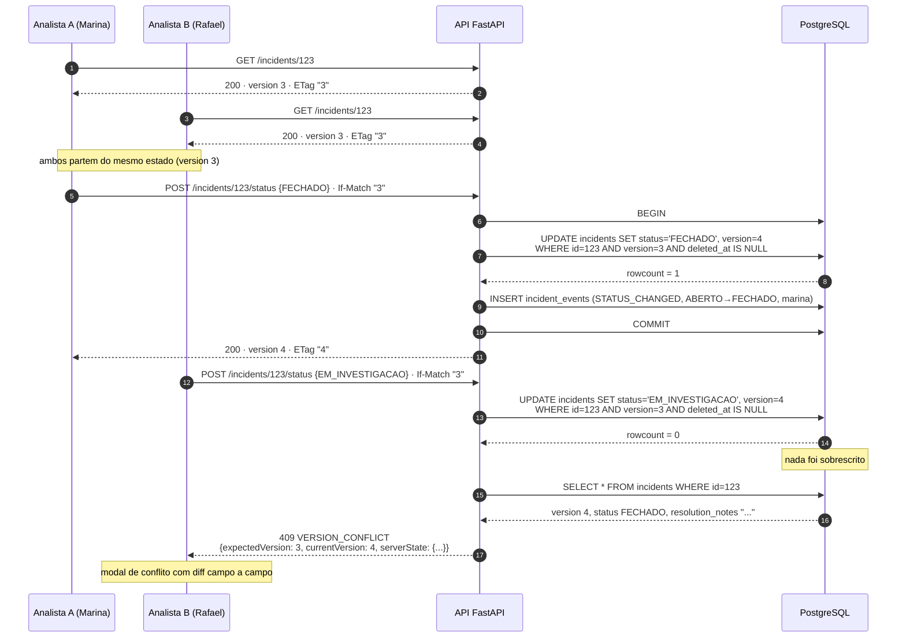
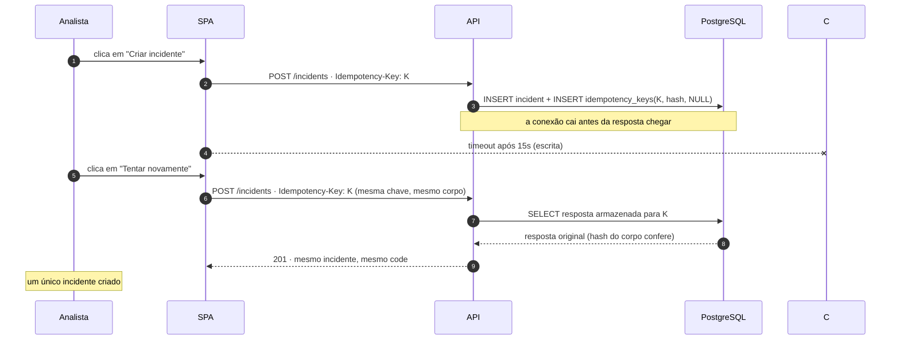
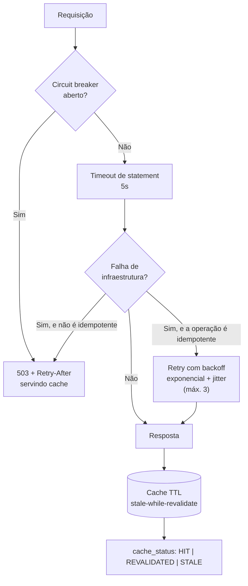
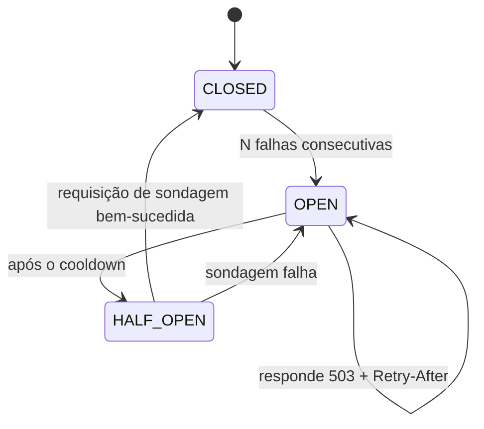

# Concorrência e Resiliência

Este documento explica como o Logos impede a perda silenciosa de decisões
quando dois analistas agem sobre o mesmo incidente e como o sistema se comporta
quando a infraestrutura falha — com o SQL, o código e as razões de cada escolha.

## 1. O problema: lost update

### 1.1 O cenário, sem código

São 14h04 de uma terça-feira. A analista **Marina** abre o incidente
`INC-2026-000123` — um acidente com vítimas na BR-116, km 412. Ela lê o
histórico, liga para o SAMU, confirma que as vítimas foram atendidas e a pista
foi liberada. Às 14h12 ela encerra o caso com a nota de resolução:
_"Vítimas atendidas pelo SAMU. Pista liberada às 14h10."_ O status vira
`FECHADO`.

O analista **Rafael** abriu o mesmo incidente às 14h10, dois minutos antes do
encerramento, e ficou com a aba parada enquanto atendia o telefone. Quando
volta, às 14h13, ele vê a tela como ela estava: status `EM_INVESTIGACAO`. Ele
decide devolver o caso para a fila para que outro analista acompanhe o
desbloqueio da via e salva.

**O que aconteceu no sistema ingênuo:** o `UPDATE` do Rafael gravou por cima do
registro da Marina. A nota de resolução foi apagada. O `closed_at` foi zerado.
O status voltou para `EM_INVESTIGACAO`. Nenhum dos dois recebeu um aviso — a
tela do Rafael mostrou "salvo com sucesso" e a tela da Marina não mudou nada
até ela atualizar a página, quando o caso já estava reaberto sem explicação.

Esse é o **lost update**: o efeito de uma operação é sobrescrito por outra que
partiu de um estado que já não existe. Na prática, custa a justificativa de uma
decisão de dezenas de milhares de reais e, no pior caso, custa horas de
caminhão parado porque o caso "reaberto" por engano saiu da fila de quem
estava resolvendo.

### 1.2 Por que o padrão inocente falha

O antipadrão tem três formas, todas com a mesma raiz:

```python
# ERRADO — três variações do mesmo problema
incident = repo.get(id)                       # lê
if incident.status != FECHADO:                # decide em Python
    incident.status = novo_status             # escreve
    session.commit()
```

O intervalo entre a leitura e a escrita é uma **janela de corrida**. Em uma
API com um único worker e uma única requisição por vez, ele não apareceria. Com
múltiplos workers do uvicorn, múltiplas réplicas e latência de rede, ele
aparece no plantão com pico de incidentes — exatamente quando o custo do erro é
maior.

Verificar em Python (`if`) não resolve: entre o `if` e o `commit` o banco mudou.
É o clássico **TOCTOU** (_time-of-check to time-of-use_).

## 2. A solução: optimistic locking com compare-and-swap

A comparação e a escrita passam a ser **a mesma instrução**. Não existe
intervalo entre decidir e gravar, porque não há decisão em Python: o banco
decide.

```sql
UPDATE incidents
   SET status       = :new_status,
       version      = version + 1,
       updated_at   = :now,
       updated_by   = :analyst,
       closed_at    = :closed_at
 WHERE id           = :id
   AND version      = :expected_version   -- a linha inteira depende disto
   AND deleted_at   IS NULL;
```

O resultado é interpretado pelo número de linhas afetadas:

| `rowcount` | Significado                                            | Resposta                                                   |
| ---------- | ------------------------------------------------------ | ---------------------------------------------------------- |
| `1`        | Ninguém alterou o recurso entre a leitura e a escrita. | `200 OK` com a nova representação e `ETag: "4"`.           |
| `0`        | Alguém alterou antes (ou o registro foi removido).     | `409 Conflict` com o estado **atual** do recurso no corpo. |

### 2.1 Onde a versão esperada vem

| Origem                        | Uso                                                                                                   |
| ----------------------------- | ----------------------------------------------------------------------------------------------------- |
| `If-Match: "3"`               | Caminho principal, com semântica HTTP correta.                                                        |
| `expectedVersion: 3` no corpo | Alternativa para teste manual no Swagger e para clientes que não manipulam cabeçalhos com facilidade. |

Se nenhum dos dois for informado em uma mudança de status, a resposta é
`422 VERSION_REQUIRED`. Não existe caminho em que o servidor "adivinhe" a
versão.

### 2.2 Por que é seguro com múltiplas réplicas

A atomicidade está no banco, não na aplicação. O `UPDATE ... WHERE` é avaliado
pelo motor em uma única operação: o predicado e a escrita pertencem à mesma
instrução, sob o mesmo _lock_ de linha que o próprio banco adquire. Duas
requisições simultâneas, em workers diferentes, em máquinas diferentes, chegam
ao mesmo veredito: uma afeta a linha, a outra afeta zero linhas.

Isso também significa que **a garantia não depende de memória compartilhada**.
Não há cache de versão, não há lock distribuído, não há `Redis`. O estado que
arbitra o conflito é o próprio dado persistido.

### 2.3 Onde isso é implementado

| Camada                                | Papel                                                                                                                             |
| ------------------------------------- | --------------------------------------------------------------------------------------------------------------------------------- |
| `repositories/incident_repository.py` | Executa o `UPDATE` condicional e devolve `rowcount` mais a representação resultante. É o único lugar do código que conhece o CAS. |
| `services/incident_service.py`        | Traduz `rowcount = 0` em `VersionConflict` do domínio, busca o estado atual e grava o evento de auditoria.                        |
| `api/v1/incidents.py`                 | Converte a exceção de domínio em `409 VERSION_CONFLICT` com `details.serverState`.                                                |

Nenhuma rota monta SQL, e nenhum service conhece `status code`.

## 3. Por que não pessimistic lock

`SELECT ... FOR UPDATE` (ou `SELECT FOR UPDATE NOWAIT`) seria tecnicamente
correto para evitar o lost update, e foi descartado por quatro razões.

**1. O lock vive enquanto a analista pensa.** Em locking pessimista, a
transação fica aberta entre a leitura e o `commit` — e esse intervalo é humano.
A analista abre o caso, lê o histórico, liga para o motorista e só então salva.
Isso são minutos com uma linha bloqueada e uma conexão do pool consumida.

**2. O pool acaba antes do banco.** Com `pool_size=5` e `max_overflow=10`, a 16ª
analista simultânea espera por conexão. Em um pico de 100 incidentes, a central
inteira serialize por falta de conexão, não por falta de capacidade do banco.

**3. O lock não sobrevive à instabilidade.** Em rede oscilante, uma conexão
perdida no meio da transação deixa o lock pendurado até o timeout. O sintoma
que a analista vê é "o sistema travou" — exatamente a dor que o produto existe
para resolver.

**4. O comportamento correto em missão crítica é informar, não bloquear.**
Existe uma decisão humana legítima a ser tomada quando dois analistas divergem:
_"eu vi que o caso foi fechado; minha mudança ainda faz sentido?"_. Bloquear a
segunda ação resolve o conflito de dados e destrói a informação. Otimista
transforma o conflito em uma tela com diff e três botões.

### 3.1 Comparação direta

| Critério                                    | Pessimistic (`SELECT FOR UPDATE`)       | Optimistic (`version`)                |
| ------------------------------------------- | --------------------------------------- | ------------------------------------- |
| Bloqueia a analista                         | Sim, pelo tempo de reflexão dela        | Nunca                                 |
| Conexão do pool                             | Presa durante a transação inteira       | Liberada a cada operação              |
| Comportamento em rede instável              | Lock pendurado, timeout, "travou"       | Detecta e informa                     |
| Comportamento com N analistas no mesmo caso | Fila de espera silenciosa               | Conflito explícito e informado        |
| Complexidade de implementação               | Média (transaction management)          | Baixa (uma cláusula `WHERE`)          |
| Custo em caso de conflito real              | Nenhum (o segundo nunca chega a tentar) | Uma requisição extra + decisão humana |

O único cenário em que pessimista ganharia é aquele em que conflitos são
frequentes e a resolução automática é sempre desejável — o oposto de uma
central de resposta a incidentes, onde cada caso é uma decisão registrada.

## 4. O fluxo completo do 409



A consulta de estado atual na linha do `rowcount = 0` é deliberada: o `409` sai
do servidor já com o que o cliente precisa para reconciliar. Sem ela, o front
teria de fazer uma segunda requisição depois de falhar, alongando o tempo em
que a analista fica sem saber o que aconteceu.

### 4.1 Corrida entre o CAS e o `SELECT`

O `SELECT` do estado atual acontece **depois** do CAS e fora da transação que
falhou. Isso é seguro porque qualquer valor lido ali é estritamente mais novo
que a versão esperada pelo cliente: a única alternativa seria o recurso ter
sido alterado de novo entre o `UPDATE` e o `SELECT`, e nesse caso o cliente
recebe uma representação ainda mais recente — que continua sendo a informação
correta a mostrar.

## 5. Tratamento no frontend

### 5.1 Mutação otimista

```ts
// features/incidents/hooks/useIncidentMutations.ts
useMutation({
  mutationFn: (input: StatusChangeInput) =>
    http.post(`/incidents/${input.id}/status`, input, {
      ifMatch: String(input.version),
      idempotencyKey: input.idempotencyKey, // gerada no onMutate, reusada no retry
    }),

  onMutate: async (input) => {
    await queryClient.cancelQueries({ queryKey: incidentKeys.detail(input.id) });
    const snapshot = queryClient.getQueryData(incidentKeys.detail(input.id));
    queryClient.setQueryData(incidentKeys.detail(input.id), (old) =>
      applyOptimisticStatus(old, input),
    );
    return { snapshot }; // contexto de rollback
  },

  onError: (error, input, context) => {
    queryClient.setQueryData(incidentKeys.detail(input.id), context?.snapshot); // rollback
    if (error.code === 'VERSION_CONFLICT') {
      openConflictDialog({ attempted: input, serverState: error.details.serverState });
    }
  },

  onSettled: (_d, _e, input) =>
    queryClient.invalidateQueries({ queryKey: incidentKeys.detail(input.id) }),
});
```

Três decisões embutidas nesse trecho:

1. **`cancelQueries` antes de aplicar o otimista.** Sem isso, um `refetch` em
   voo sobrescreve a atualização local e a interface pisca.
2. **`snapshot` como contexto de rollback.** O `onError` restaura exatamente o
   estado anterior, sem uma nova ida ao servidor.
3. **`Idempotency-Key` gerada no `onMutate`.** Como ela é criada antes da
   primeira tentativa e vive no contexto da mutação, o botão "Tentar novamente"
   reenvia a mesma chave — o que torna a repetição segura.

### 5.2 O que o modal de conflito mostra

O diálogo não exibe "erro 409". Ele exibe a divergência em linguagem de operação:

| Campo             | Você tentou     | No servidor está                                      |
| ----------------- | --------------- | ----------------------------------------------------- |
| Status            | Em Investigação | **Fechado**                                           |
| Responsável       | Rafael L.       | Marina S.                                             |
| Nota de resolução | —               | Vítimas atendidas pelo SAMU. Pista liberada às 14h10. |

Ações oferecidas: **Ver o que mudou** (abre a timeline), **Recarregar**
(descarta a tentativa e traz o estado atual) e **Fechar** (mantém o estado do
servidor na tela). Nunca há um botão "sobrescrever mesmo assim": sobrescrever
uma decisão humana registrada não é uma operação que a interface deva oferecer
em um clique.

### 5.3 Comportamento por classe de erro

| Erro                      | Comportamento da interface                                                                                      |
| ------------------------- | --------------------------------------------------------------------------------------------------------------- |
| `409 VERSION_CONFLICT`    | Rollback da atualização otimista, abre o modal de conflito com o diff.                                          |
| `412 PRECONDITION_FAILED` | Rollback, recarrega o recurso e pede nova confirmação.                                                          |
| `422`                     | Rollback, destaca o campo inválido. Não repete automaticamente.                                                 |
| `503` / timeout           | **Mantém a UI otimista**, mostra toast _"Instável — vamos tentar de novo"_ e deixa o retry com backoff assumir. |
| `429`                     | Respeita `Retry-After` e agenda nova tentativa.                                                                 |

Em nenhum caso a aplicação executa `window.location.reload()`. Recarregar a
página destrói o contexto da analista — filtros, scroll e posição na fila — e
é justamente o que ela não pode perder no meio de um plantão.

## 6. Idempotência

O lock otimista resolve a **sobrescrita indevida**. A idempotência resolve o
problema irmão: a **duplicação por retry**. São problemas diferentes com o mesmo
gatilho — rede instável.

### 6.1 Mecanismo

Todo `POST` e `PATCH` aceita `Idempotency-Key: <uuid v4>`. O servidor persiste,
por 24 horas, a tripla `(key, hash do corpo, resposta)`.

| Cenário                         | Comportamento                                 |
| ------------------------------- | --------------------------------------------- |
| Chave nova                      | Processa normalmente e armazena o resultado.  |
| Chave repetida, mesmo corpo     | Devolve a resposta original, sem reprocessar. |
| Chave repetida, corpo diferente | `409 IDEMPOTENCY_KEY_REUSED`.                 |
| Chave em processamento          | `409 IDEMPOTENCY_KEY_IN_PROGRESS`.            |

### 6.2 A sequência que isso resolve



Sem a chave, a repetição criaria um segundo incidente — o "cliquei três vezes
porque travou" descrito na persona da Marina. Com ela, o retry do cliente é
seguro por construção, e a interface pode oferecer "Tentar novamente" sem
medo.

### 6.3 Relação com o lock otimista

| Mecanismo          | Protege contra                                               | Chave                  |
| ------------------ | ------------------------------------------------------------ | ---------------------- |
| Optimistic locking | Duas decisões distintas e conflitantes sobre o mesmo recurso | `version` / `If-Match` |
| Idempotência       | A mesma decisão aplicada duas vezes                          | `Idempotency-Key`      |

Os dois são necessários e não se substituem: a versão impede sobrescrever, a
chave impede duplicar. Um `PATCH` reenviado com `Idempotency-Key` retorna a
primeira resposta mesmo que a `version` tenha avançado, porque a operação já
foi aplicada.

## 7. Camada de resiliência

### 7.1 Visão geral



### 7.2 Camada por camada

| Camada              | Configuração                                                                                                                                           | O que resolve                                                                                                                                      |
| ------------------- | ------------------------------------------------------------------------------------------------------------------------------------------------------ | -------------------------------------------------------------------------------------------------------------------------------------------------- |
| **Pool**            | `pool_pre_ping=True`, `pool_size=5`, `max_overflow=10`, `pool_recycle=1800`                                                                            | Conexões mortas por _idle_ são recicladas em vez de entregues à analista como erro.                                                                |
| **Timeout**         | `statement_timeout` e `idle_in_transaction_session_timeout` (PostgreSQL) / `busy_timeout` e `connect_timeout` (SQLite e conexão)                       | Uma query patológica é cancelada com SQLSTATE `57014` em vez de pendurar o worker para sempre; a transação ociosa é morta em vez de segurar locks. |
| **Retry**           | Exponencial com jitter, máximo 3 tentativas, apenas em `OperationalError`, `SerializationFailure` e `TimeoutError`, e apenas em operações idempotentes | Absorve blips de rede e picos momentâneos de contenção sem duplicar efeitos.                                                                       |
| **Circuit breaker** | Abre após N falhas consecutivas; responde `503` com `Retry-After` e o último cache conhecido                                                           | Falha rápido em vez de enfileirar requisições condenadas — o que protege o banco na volta.                                                         |
| **Cache**           | TTL curto na listagem, com _stale-while-revalidate_                                                                                                    | Em degradação, serve dado ligeiramente velho mas **utilizável**, em vez de tela de erro.                                                           |
| **Rate limit**      | Token bucket por IP: 60 req/min em leitura, limite menor em escrita                                                                                    | Contém loop de retry do próprio cliente, que é uma das causas de sobrecarga em incidentes.                                                         |
| **Shutdown**        | `lifespan` fecha o pool e finaliza requisições em voo                                                                                                  | Deploy não derruba requisição no meio.                                                                                                             |
| **Observabilidade** | Log JSON com `requestId`, método, rota, status e duração                                                                                               | Correlaciona o que a analista viu com o que o servidor fez.                                                                                        |

### 7.3 Retry com backoff exponencial e jitter

```python
@dataclass(frozen=True, slots=True)
class RetryPolicy:
    max_attempts: int = 3
    base_delay: float = 1.0
    factor: float = 2.0
    max_delay: float = 8.0

    def ceiling_for(self, attempt: int) -> float:
        """Teto da espera após a tentativa informada: 1 s, 2 s, 4 s, 8 s…"""
        return min(self.max_delay, self.base_delay * (self.factor ** (attempt - 1)))

    def delay_for(self, attempt: int) -> float:
        """Jitter completo: uniforme entre 0 e o teto da tentativa.

        O jitter não é enfeite. Quando o banco volta depois de uma
        indisponibilidade, todas as requisições que estavam falhando tentam
        reconectar no mesmo instante e derrubam o banco de novo (thundering
        herd). Sortear a espera espalha as tentativas e evita que o retry seja
        o causador da segunda queda.
        """
        return random.uniform(0, self.ceiling_for(attempt))
```

| Tentativa | Teto do backoff | Atraso efetivo (0..teto) |
| --------- | --------------- | ------------------------ |
| 1         | 1,0 s           | 0 a 1,0 s                |
| 2         | 2,0 s           | 0 a 2,0 s                |
| 3         | 4,0 s           | 0 a 4,0 s                |
| 4+        | 8,0 s (teto)    | 0 a 8,0 s                |

O retry é aplicado **somente** quando as três condições valem:

1. A falha é de infraestrutura: `OperationalError`, `DisconnectionError`,
   `TimeoutError` ou um SQLSTATE transitório — `40001` (_serialization
   failure_), `40P01` (_deadlock_), `57014` (_statement timeout_) e a família
   `08` (conexão). Erro de validação, violação de constraint ou conflito de
   versão não se resolve repetindo; repetir só consome tempo e mascara o
   problema. A classificação é por código, e não por texto da mensagem, porque a
   mensagem muda entre versões do driver.
2. A operação é repetível: leitura sempre; escrita só quando o cliente enviou
   `Idempotency-Key`, que é a declaração de que o reenvio é esperado.
3. A escrita é guardada por compare-and-swap. **`INSERT` nunca é repetido**: o
   `POST /incidents` que falhou depois de um commit que o cliente não viu criaria
   um segundo incidente. Nesse caso a API devolve `503` com `Retry-After` e quem
   reenvia é o cliente, com a mesma chave — que é exatamente o papel da
   idempotência no nível HTTP.

A retentativa envolve a **unidade de trabalho inteira**, e não cada consulta:
repetir uma consulta isolada deixaria a operação pela metade, com parte das
escritas aplicada e outra parte não. Entre as tentativas a sessão recebe
`rollback()`, para a próxima começar de um estado limpo em vez de herdar a
transação abortada.

### 7.4 Cache com _stale-while-revalidate_

O cache da listagem tem três estados, expostos no cabeçalho `X-Cache-Status`
para que o comportamento seja observável em desenvolvimento e nos logs:

| Estado        | Quando                                                          | O que acontece                                                                                    |
| ------------- | --------------------------------------------------------------- | ------------------------------------------------------------------------------------------------- |
| `MISS`        | Não havia cópia guardada                                        | A resposta vem do banco e passa a ser guardada.                                                   |
| `HIT`         | Dentro do TTL                                                   | Resposta imediata do cache, sem tocar no banco.                                                   |
| `REVALIDATED` | TTL expirado, atualização bem-sucedida                          | Busca no banco, atualiza o cache e responde com o dado novo.                                      |
| `STALE`       | TTL expirado e o banco indisponível ou o circuit breaker aberto | Serve o valor antigo **marcado como defasado**, para a interface exibir o aviso de instabilidade. |

O ponto central: um dado de 30 segundos atrás é **utilizável** para triagem —
a analista precisa saber que o incidente existe e qual sua prioridade. Uma tela
de erro não é útil. Por isso o cache degrada em vez de falhar, e por isso ele
nunca é tratado como fonte de verdade: toda mutação vai ao banco.

Quatro decisões que valem registro:

- **A chave é o pedido inteiro** — filtros, ordenação, limite e cursor. Servir a
  página de um filtro para outro entregaria dado errado com aparência de certo,
  que é o pior tipo de erro de cache, porque não parece erro.
- **Toda mutação bem-sucedida esvazia o cache.** Invalidar só a chave afetada
  exigiria saber quais combinações de filtro incluem o registro alterado; errar
  isso **esconderia a mudança** de quem olha a lista. Um cache frio custa uma
  consulta a mais; um cache errado custa a confiança no painel.
- **O "em segundo plano" é adiado, não concorrente.** A revalidação não roda em
  thread própria: quem revalida é a próxima requisição que encontrar o banco de
  volta. O efeito para quem usa é o mesmo — a tela não espera por uma
  revalidação que provavelmente vai falhar —, sem gerenciar threads, filas e
  erros que ninguém observa.
- **Sem cópia guardada, o `503` sobe.** Devolver lista vazia seria mentir sobre o
  estado do sistema: "não há incidentes" e "não consigo ler os incidentes" são
  coisas diferentes, e confundi-las numa central de incidentes é perigoso.

A degradação é reconhecida por **dois** caminhos: o circuito já aberto, que
recusa sem tocar no banco, e a falha transitória que **acabou de abri-lo**. Sem o
segundo, a primeira requisição durante a queda receberia erro tendo cópia
guardada — exatamente o que este cache existe para evitar. Erro de cliente, como
cursor inválido, não conta como degradação: servir dado antigo para um pedido
malformado esconderia o defeito em vez de mostrá-lo.

**Limite honesto:** o cache vive na memória do processo. Com N workers há N
caches, cada um com a sua taxa de acerto. Trocar por Redis é substituir o
dicionário; a política de estados não muda.

### 7.5 Circuit breaker



Com o circuito aberto, a API não tenta o banco: responde `503` com `Retry-After`
imediatamente. Isso transforma um incidente de infraestrutura em uma degradação
visível em vez de uma fila de timeouts — e libera o pool, dando ao banco espaço
para se recuperar.

| Parâmetro                      | Padrão | Configuração                        |
| ------------------------------ | ------ | ----------------------------------- |
| Falhas consecutivas para abrir | 5      | `CIRCUIT_BREAKER_FAILURE_THRESHOLD` |
| Espera antes da sondagem       | 30 s   | `CIRCUIT_BREAKER_COOLDOWN_SECONDS`  |
| Desligar o disjuntor           | —      | `CIRCUIT_BREAKER_ENABLED=false`     |

Três decisões que valem registro:

- **Uma sondagem de cada vez.** Vencido o cooldown, o circuito vai para
  `HALF_OPEN` e autoriza **uma** requisição. Liberar tráfego em massa para um
  banco que talvez não tenha voltado o derrubaria de novo — seria o disjuntor
  causando a segunda queda.
- **A sonda que falha reabre na hora**, sem esperar o limiar de novo: o banco já
  provou que não voltou, e contar outra vez só atrasaria a proteção.
- **Falha é a unidade de trabalho, não a tentativa interna.** Cinco requisições
  que falharam, e não as quinze tentativas de cinco requisições — assim o limiar
  não muda de significado quando alguém ajusta a política de retentativa.

Erro de negócio **não** conta como falha. Um `404` que chega rápido prova que o
banco respondeu; contá-lo como doença faria o disjuntor abrir por causa de
tráfego normal.

O liveness (`/health/live`) continua respondendo `200` com o circuito aberto. Se
ele caísse junto, a plataforma reiniciaria o serviço — o que não conserta o banco
e ainda derruba o processo que estava de pé.

### O que faz o disjuntor funcionar de verdade

Um disjuntor só age sobre falhas que **acontecem**. Com o `connect_timeout`
padrão do driver — que é zero, ou seja, esperar para sempre —, uma requisição
contra um banco inalcançável não falha: fica pendurada. Nenhuma falha chega ao
contador, o circuito nunca abre, e o resultado é exatamente a fila de timeouts
que o disjuntor deveria evitar.

Medido com o container do banco parado:

| Momento                               | Antes                      | Com o `connect_timeout`              |
| ------------------------------------- | -------------------------- | ------------------------------------ |
| 1ª requisição                         | pendurada por **> 12 min** | `503` em ~21 s                       |
| 2ª requisição                         | —                          | `503` em ~21 s (abre o circuito)     |
| 3ª requisição                         | —                          | `503` em **10 ms**, `Retry-After: 5` |
| `/health/live` e `/meta/enums`        | —                          | `200` em 38 ms                       |
| Após o cooldown, com o banco de volta | —                          | `200` em 157 ms                      |

É por isso que o `connect_timeout` entrou nesta issue e não na #28: sem ele o
critério "falhar rápido" não é atingível. O `statement_timeout` — limite por
**consulta**, e não por conexão — continua na #28.

A entrega do cache junto com o `503` faz parte da issue #30
(_stale-while-revalidate_); aqui o `503` já carrega o `Retry-After`.

Do lado da interface, `503` não é tratado como erro fatal: o card de erro mantém
o cache na tela, mostra _"Instável — vamos tentar de novo"_ e o retry com backoff
assume.

**Limite honesto desta implementação:** o estado vive na memória do processo. Com
N workers há N disjuntores, e cada um abre por conta própria — o banco precisa de
N vezes mais falhas para que todos abram. Guardar o estado em Redis adicionaria
uma dependência que cai junto com o banco, e o disjuntor existe justamente para o
momento em que as coisas caem.

### 7.6 Rate limit

Janela deslizante por cliente, com cotas diferentes para leitura e escrita. O
objetivo principal não é defesa contra ataque, é conter o **loop de retry do
próprio cliente** — que é exatamente o que acontece quando a rede oscila e o
front insiste. Excedido o limite: `429` com `Retry-After`, e a interface agenda
nova tentativa em vez de insistir.

A janela é deslizante, e não fixa, porque a fixa permite gastar o teto nos
últimos segundos de um minuto e de novo nos primeiros do seguinte — o dobro do
limite em um instante curto. Com a deslizante, o teto vale a qualquer momento, e
o `Retry-After` devolvido é o tempo exato até a requisição mais antiga sair da
janela.

`/health/live` e `/health/ready` ficam isentos de cota. Recusar o healthcheck
faria a plataforma marcar o serviço como doente e reiniciar o deploy — o
limitador derrubaria o próprio serviço que ele deveria proteger.

**Limite honesto desta implementação:** o histórico vive na memória do processo.
Isso é exato com uma instância e passa a valer _por worker_ quando houver várias,
o que na prática multiplica o teto pelo número de workers. Trocar por um store
compartilhado (Redis) é substituir a estrutura que guarda o histórico; o
middleware e o contrato com o cliente não mudam.

## 8. Por que não confiar em retry cego em `PATCH`

Esta é a decisão mais sutil do documento e a que mais depende de raciocínio
sobre _quando_ a falha aconteceu.

### 8.1 Reexecutar um `PATCH` não é como reexecutar um `GET`

Um `GET` que falha não tem efeito colateral: repetir é sempre seguro. Um `PATCH`
de status **é uma decisão humana materializada**. Repetir a operação não é
neutro — é reafirmar a decisão, e a decisão pode ter sido correta no momento em
que foi enviada e incorreta no momento em que é reenviada.

O problema é que, quando a resposta se perde, o cliente **não sabe** se:

- (a) o servidor nunca recebeu a requisição; ou
- (b) o servidor recebeu, executou e o `200` se perdeu no caminho de volta.

Nos dois casos, o sintoma no cliente é idêntico: timeout. O comportamento
correto é diferente.

### 8.2 A regra aplicada

| Situação                                                                                              | Estratégia                                                                                    |
| ----------------------------------------------------------------------------------------------------- | --------------------------------------------------------------------------------------------- |
| Falha **antes** de a transação iniciar (não foi possível obter conexão, timeout de aquisição do pool) | Retry interno permitido. Nenhum efeito foi aplicado.                                          |
| Falha **durante** a transação, antes do `COMMIT`                                                      | Retry interno permitido, desde que a transação tenha sido revertida.                          |
| Falha **após** o `COMMIT` ou em momento indeterminado (timeout de resposta, queda de rede na volta)   | **Sem retry.** A API devolve `503` e o cliente decide.                                        |
| Mutação **com** `Idempotency-Key` válida                                                              | Retry seguro. O servidor reconhece a chave e devolve a resposta original em vez de reaplicar. |
| Mutação **sem** `Idempotency-Key`                                                                     | Tratada como caso de risco: sem retry automático, retorno de `503` com `Retry-After`.         |

### 8.3 Por que não basta "só repetir se for idempotente pelo método"

Repetir um `PATCH` com o mesmo corpo parece idempotente: o estado final seria o
mesmo. Mas o cerne do problema não é o estado final — é a **decisão
registrada**. Se a primeira tentativa fechou o caso e a segunda tenta aplicar
`EM_INVESTIGACAO`, o resultado não é "o mesmo estado final"; é uma reabertura
silenciosa. O lock otimista impediria a segunda aplicação por conflito de
versão, mas o instrumento correto é não emitir a segunda requisição sem
informação de causalidade.

Por isso a chave de idempotência é o mecanismo explícito de intenção: ela afirma
_"esta é a mesma tentativa de antes"_. Sem ela, a API não tem como distinguir
entre "repetição da mesma decisão" e "nova decisão" — e a resposta honesta é
não agir e informar.

### 8.4 O que a interface faz nesse caso

1. A UI otimista **permanece aplicada** (a analista vê a mudança que pediu).
2. Um toast informa: _"Instável — vamos tentar de novo"_.
3. O botão "Tentar novamente" reenvia com a **mesma** `Idempotency-Key`, o que
   torna a repetição segura.
4. Se o `503` persistir, o banner de offline assume e a alteração entra na fila
   de reenvio.

O ponto 3 é o que fecha o ciclo: sem a chave, a única ação honesta seria
perguntar à analista se ela quer repetir uma operação de efeito indeterminado.

## 9. Resumo das garantias

| Garantia                                | Mecanismo                                                 | Como é comprovado                                                                                       |
| --------------------------------------- | --------------------------------------------------------- | ------------------------------------------------------------------------------------------------------- |
| Nenhuma sobrescrita silenciosa          | `UPDATE ... WHERE version = :expected`                    | `tests/concurrency` com `ThreadPoolExecutor`: exatamente uma requisição vence, as demais recebem `409`. |
| Nenhuma duplicação por retry            | `Idempotency-Key` persistida por 24 h                     | Teste de integração que reenvia a mesma chave com o mesmo corpo e confere que o recurso não é recriado. |
| Nenhum `500` por entrada inesperada     | Pydantic v2 + envelope de erro único                      | Testes de integração cobrindo `400`, `409`, `412`, `422`, `429` e `503`.                                |
| Degradação visível, não quebra          | Circuit breaker + cache _stale_ + `503` com `Retry-After` | Testes de infraestrutura e verificação manual com o banco derrubado.                                    |
| Retry que não derruba o banco na volta  | Backoff exponencial com jitter completo                   | Teste unitário da distribuição dos atrasos.                                                             |
| Conflito sempre visível para a analista | Modal de conflito com diff campo a campo                  | Teste de componente do `ConflictDialog` e demonstração em duas abas.                                    |
