# Workflow de Git e GitHub

Este documento descreve como o trabalho entra na `main` no projeto Logos:
modelo de branching, nomenclatura, padrão de commit, fluxo por issue, labels,
milestones, regras de proteção da branch principal e política de versionamento.

## 1. Modelo de branching: trunk-based

`main` é a única branch de longa duração. Ela está **sempre verde e sempre
implantável**: qualquer commit nela poderia ir para produção.

```
main ──●──●──────────●──────────●──────────●──────►  (sempre verde)
        \            /          /          /
         feat/20-…  ┘   fix/31-…┘  docs/70-…┘
         (vida útil de horas a 2 dias)
```

### 1.1 Regras

| Regra                                  | Motivo                                                           |
| -------------------------------------- | ---------------------------------------------------------------- |
| Uma issue por branch                   | Torna o PR revisável e o histórico rastreável.                   |
| Branch com vida útil de horas a 2 dias | Branch longa esconde conflito até o fim, quando resolver é caro. |
| Sem push direto na `main`              | A branch é protegida; toda mudança entra por PR.                 |
| Rebase em `main` em vez de merge       | Mantém o histórico linear e legível.                             |
| Merge por **Squash and merge**         | Um commit por issue na `main`; o título do PR vira a mensagem.   |
| Branch apagada após o merge            | O repositório não acumula branches mortas.                       |

### 1.2 Desenvolvimento em trunk-based com tudo na `main`

Trabalhar direto na `main` seria mais rápido e é o que a maioria dos projetos de
uma pessoa faz. Não é o que este projeto faz, por um motivo específico: **o
briefing avalia o processo**. O histórico de PRs, os checks de CI e os commits
semânticos são evidência observável de como o código foi construído.

Além disso, a branch protegida com CI obrigatório é a rede de segurança que
importa em um projeto com 72 issues e prazo curto: não existe caminho em que um
`push` quebrado chegue à `main` sem lint, tipos, testes e build passarem.

## 2. Nomenclatura de branch

```
<tipo>/<numero-da-issue>-<slug-curto-em-kebab-case>
```

| Prefixo     | Uso                                    | Exemplo                                |
| ----------- | -------------------------------------- | -------------------------------------- |
| `feat/`     | Nova funcionalidade                    | `feat/20-optimistic-lock`              |
| `fix/`      | Correção de defeito                    | `fix/31-cursor-pagination-off-by-one`  |
| `refactor/` | Reestruturação sem mudar comportamento | `refactor/22-extract-priority-service` |
| `test/`     | Apenas testes                          | `test/26-concurrency-test`             |
| `docs/`     | Apenas documentação                    | `docs/70-adrs`                         |
| `chore/`    | Build, dependências e configuração     | `chore/3-husky`                        |
| `perf/`     | Performance                            | `perf/43-virtual-list`                 |

O número da issue no nome é o que liga branch, PR e issue sem depender de
memória ou de busca no GitHub.

```bash
# criar a branch a partir da main atualizada
git switch main && git pull --ff-only
git switch -c feat/20-optimistic-lock
```

## 3. Conventional Commits

### 3.1 Formato

```
<tipo>(<escopo>): <descrição no imperativo, minúscula, sem ponto final>

<corpo: o PORQUÊ da mudança, não o "o quê">
<quebra de linha a cada 72 colunas>

<footer: refs, breaking changes>
```

### 3.2 Tipos permitidos

| Tipo       | Quando usar                                                          |
| ---------- | -------------------------------------------------------------------- |
| `feat`     | Funcionalidade nova para quem usa o produto.                         |
| `fix`      | Correção de defeito.                                                 |
| `docs`     | Apenas documentação.                                                 |
| `style`    | Formatação, espaços, ponto e vírgula — sem mudança de comportamento. |
| `refactor` | Reestruturação que não altera comportamento observável.              |
| `perf`     | Melhoria de desempenho.                                              |
| `test`     | Adição ou ajuste de testes.                                          |
| `build`    | Sistema de build ou dependências.                                    |
| `ci`       | Configuração e scripts de integração contínua.                       |
| `chore`    | Manutenção que não se encaixa nas anteriores.                        |
| `revert`   | Reversão de commit anterior.                                         |

### 3.3 Escopos permitidos

`api` · `web` · `db` · `ux` · `ci` · `docs` · `deps` · `infra` · `release`

O escopo responde "que parte do sistema mudou" sem exigir a leitura do diff.
`api` cobre o backend, `web` o frontend, `db` schema e migrações, `ux` decisões
de interface, `infra` deploy e ambiente.

### 3.4 Limites aplicados pelo `commitlint`

```js
// commitlint.config.cjs
rules: {
  'header-max-length': [2, 'always', 72],
  'body-max-line-length': [2, 'always', 100],
  'subject-case': [2, 'never', ['upper-case', 'pascal-case']],
}
```

Mensagem fora do padrão é rejeitada localmente pelo hook `commit-msg`, com a
regra violada na tela. O mesmo conjunto roda na CI no job `commits`, o que
impede que uma mensagem inválida entre por um caminho que ignore os hooks.

### 3.5 Exemplos reais

**Funcionalidade de concorrência:**

```
feat(api): adiciona lock otimista na transição de status

Dois analistas podiam sobrescrever o mesmo incidente quando abriam a
tela antes de o colega salvar. A comparação e a escrita passam a ser
uma única instrução UPDATE ... WHERE version = :expected, eliminando
a janela de corrida (TOCTOU) mesmo com múltiplos workers.

Refs #18
```

**Correção com impacto de UX:**

```
fix(web): impede reordenação da lista ao chegar evento via SSE

A lista reordenava embaixo do cursor do analista e causava clique no
incidente errado. Novos eventos passam a alimentar um contador e a
lista só reordena sob ação explícita.

Closes #35
```

**Melhoria de desempenho:**

```
perf(web): virtualiza a lista de incidentes

Com 100+ itens o DOM mantinha mais de 3.000 nós e o scroll engasgava.
A virtualização reduz para ~20 linhas montadas e mantém 60fps.

Refs #29
```

Nos três exemplos, o corpo explica o **porquê**. O `diff` já mostra o "o quê";
o corpo existe para registrar a razão, que não é recuperável lendo o código
depois.

### 3.6 Divisão de commits dentro do PR

Um commit por unidade lógica coerente. Ao construir uma funcionalidade de
backend, a sequência típica é:

```
1. schema       → feat(api): adiciona schema de mudança de status
2. repositório  → feat(api): implementa update condicional por versão
3. serviço      → feat(api): valida transição e traduz conflito de versão
4. rota         → feat(api): expõe POST /incidents/{id}/status
5. teste        → test(api): cobre corrida de status com ThreadPoolExecutor
6. doc          → docs: documenta o fluxo de conflito 409
```

Essa granularidade demonstra o processo de construção, que é um critério de
avaliação explícito. O squash final preserva a mensagem completa do corpo no
commit resultante da `main`.

### 3.7 Conventional Commits e SemVer

Os tipos têm efeito direto na versão:

| Commit                                  | Efeito na versão            |
| --------------------------------------- | --------------------------- |
| `fix`                                   | `PATCH` (`0.1.0` → `0.1.1`) |
| `feat`                                  | `MINOR` (`0.1.0` → `0.2.0`) |
| `feat!` ou `BREAKING CHANGE:` no footer | `MAJOR` (`0.1.0` → `1.0.0`) |

Enquanto o projeto estiver em `0.x`, uma quebra de compatibilidade pode ocorrer
em `MINOR`. A política estrita passa a valer a partir de `v1.0.0`.

## 4. Fluxo de trabalho por issue

```mermaid
flowchart LR
    A["Issue no GitHub<br/>com labels e milestone"] --> B["gh issue develop<br/>cria a branch a partir da main"]
    B --> C["Commits atômicos<br/>Conventional Commits"]
    C --> D["pnpm verify<br/>lint + types + testes + build"]
    D -->|vermelho| C
    D -->|verde| E["git push + gh pr create<br/>com Closes #N"]
    E --> F["CI roda no PR<br/>backend · frontend · commits"]
    F -->|falha| C
    F -->|verde| G["Self-review no diff completo<br/>+ checklist do template"]
    G --> H["Squash and merge<br/>na main"]
    H --> I["Apagar branch<br/>e fechar a issue"]
    I --> J["Tag se a issue fechar um marco"]
```



### 4.1 Comandos do ciclo

```bash
# 1. criar a branch a partir da issue
gh issue develop 20 --name feat/20-optimistic-lock --checkout

# 2. desenvolver com commits atômicos
git add backend/app/repositories/incident_repository.py
git commit -m "feat(api): implementa update condicional por versão"

# 3. verificar exatamente o que a CI verifica
pnpm verify

# 4. publicar e abrir o PR
git push -u origin feat/20-optimistic-lock
gh pr create --base main --fill

# 5. após o CI verde e o self-review
gh pr merge --squash --delete-branch
```

## 5. Labels

Paleta organizada por grupo, para permitir filtro por `label:type:feat
label:area:api` na busca do GitHub.

| Grupo       | Labels                                                                                  |
| ----------- | --------------------------------------------------------------------------------------- |
| Tipo        | `type:feat` `type:fix` `type:refactor` `type:test` `type:docs` `type:chore` `type:perf` |
| Área        | `area:api` `area:web` `area:db` `area:ux` `area:ci` `area:infra`                        |
| Prioridade  | `prio:critical` `prio:high` `prio:medium` `prio:low`                                    |
| Esforço     | `size:XS` `size:S` `size:M` `size:L` `size:XL`                                          |
| Estado      | `status:blocked` `status:needs-review` `status:wontfix` `good first issue`              |
| Diferencial | `diferencial` `documentação` `resiliência` `performance`                                |

Cada issue recebe no mínimo: um `type:*`, um `area:*`, um `prio:*` e um
`size:*`. Sem isso, a issue não entra em uma milestone.

## 6. Milestones

Uma milestone por épico. Elas dão a leitura de progresso por bloco de trabalho,
e não por contagem bruta de issues.

| Milestone                         | Épico      | Objetivo resumido                                             |
| --------------------------------- | ---------- | ------------------------------------------------------------- |
| `M0 — Fundação`                   | E0         | Repositório, workspaces, lint, hooks, CI, templates           |
| `M1 — Backend Core`               | E1         | Domínio, ORM, migrações, CRUD, seed                           |
| `M2 — Concorrência & Resiliência` | E2, E3     | Máquina de estados, lock otimista, idempotência, retry, cache |
| `M3 — Frontend UX`                | E4, E5, E6 | Fundação do front, triagem, ciclo de vida e conflito          |
| `M4 — Qualidade`                  | E7         | Testes unitários, integração, componente e E2E                |
| `M5 — Deploy & Entrega`           | E8, E9     | Publicação, observabilidade, documentação e vídeo             |

### 6.1 Quadro de trabalho

GitHub Projects em modo Kanban, com as colunas `Backlog` → `Ready` →
`In Progress` → `In Review` → `Done`, campo customizado `Épico` e o campo
automático de PR vinculado.

## 7. Pull requests

### 7.1 Template

Todo PR preenche o `PULL_REQUEST_TEMPLATE.md`, que exige:

| Item             | Conteúdo esperado                                               |
| ---------------- | --------------------------------------------------------------- |
| Issue vinculada  | `Closes #N` no corpo.                                           |
| Tipo de mudança  | Feature, correção, refatoração, documentação ou infraestrutura. |
| O porquê         | Duas a três frases sobre o motivo, não sobre a implementação.   |
| Como testar      | Passos objetivos de reprodução.                                 |
| Evidência visual | Print ou GIF sempre que a interface mudar.                      |
| Checklist de DoD | Os dez itens de qualidade, marcados pelo autor.                 |

### 7.2 Tamanho

Um PR deve ser revisável em uma sentada. Se o diff passa de aproximadamente 400
linhas úteis, o escopo estava grande demais — é sinal de que a issue precisava
ter sido quebrada.

### 7.3 Self-review

Como o projeto tem um único desenvolvedor, o self-review é obrigatório e
explícito: o autor lê o próprio diff como se fosse código de outra pessoa,
antes de mergear. É a etapa em que se encontram `console.log` esquecidos,
código comentado, `TODO` solto e tratamento de erro faltando.

## 8. Proteção da branch `main`

| Regra                                            | Valor                                           |
| ------------------------------------------------ | ----------------------------------------------- |
| Require a pull request before merging            | Ativado                                         |
| Require approvals                                | 1 (o próprio autor, no self-review)             |
| Require status checks to pass                    | `ci / backend`, `ci / frontend`, `ci / commits` |
| Require branches to be up to date before merging | Ativado                                         |
| Require linear history                           | Ativado (o squash garante)                      |
| Require conversation resolution                  | Ativado                                         |
| Allow force pushes                               | **Proibido**                                    |
| Allow deletions                                  | **Proibido**                                    |

A `main` ser linear também tem uma consequência prática: `git log --oneline`
mostra a evolução do produto como uma sequência de decisões, e não como uma
teia de merges.

## 9. Fluxo do CI

```yaml
# .github/workflows/ci.yml (estrutura)
on:
  push: { branches: [main] }
  pull_request: { branches: [main] }

concurrency:
  group: ci-${{ github.ref }}
  cancel-in-progress: true
```

| Job        | Etapas                                                              |
| ---------- | ------------------------------------------------------------------- |
| `backend`  | `ruff check .` · `ruff format --check .` · `mypy app` · `pytest -q` |
| `frontend` | `pnpm --filter web lint` · `typecheck` · `test:run` · `build`       |
| `commits`  | `commitlint --from <base.sha> --to <sha>` (apenas em PR)            |

O `concurrency` com `cancel-in-progress` cancela execuções antigas quando um
push novo chega na mesma branch — economiza minutos de CI e mostra o resultado
do código mais recente primeiro.

## 10. Versionamento semântico e tags

### 10.1 Tags previstas

| Tag      | Marco                     | Critério para criar                                                          |
| -------- | ------------------------- | ---------------------------------------------------------------------------- |
| `v0.1.0` | API publicada e funcional | Backend no ar, CRUD completo, lock otimista e teste de concorrência verdes.  |
| `v0.2.0` | Frontend integrado        | Fluxo de triagem completo em produção: listar, filtrar, abrir, mudar status. |
| `v1.0.0` | Entrega final             | Documentação, testes, deploy e vídeo publicados.                             |

### 10.2 Criando uma release

```bash
git switch main && git pull --ff-only
git tag -a v0.1.0 -m "v0.1.0 — API publicada, com lock otimista e teste de concorrência"
git push origin v0.1.0
gh release create v0.1.0 --generate-notes
```

As notas são geradas dos commits e depois revisadas à mão: entradas do tipo
`chore` e `docs` internas costumam ser removidas, porque não interessam a quem
acompanha as versões.

### 10.3 O que não fazer

- Um único commit `"case AutoU"` ou uma sequência de `"wip"`, `"ajustes"` e
  `"correções"`.
- Tag sem commit correspondente na `main`.
- `--amend` em massa no final: o histórico precisa refletir o desenvolvimento
  real, que é o que está sendo avaliado.
- Commits retroativos escritos de uma só vez no último dia.
