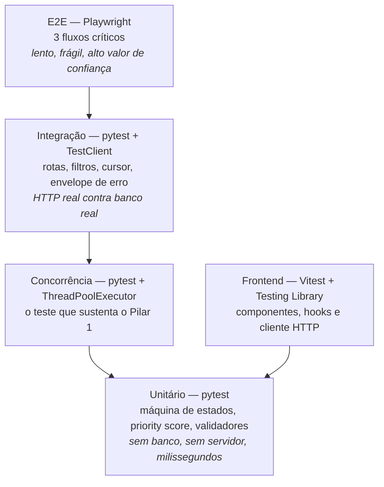

# Estratégia de Testes

Este documento define os níveis de teste do Logos, o que cada um cobre, como
executá-los, a mecânica do teste de concorrência e o que fica reservado para os
testes ponta a ponta.

## 1. A pirâmide aplicada

A pirâmide clássica — muitos testes unitários, alguns de integração, poucos
ponta a ponta — é seguida porque ela é a que dá **retorno por segundo de
execução**. No Logos, ela se traduz assim:



| Nível | Ferramenta | Volume | Tempo alvo |
| --- | --- | --- | --- |
| Unitário | pytest | Maioria | Milissegundos por teste |
| Integração | pytest + `TestClient` | Moderado | Décimos de segundo |
| Concorrência | pytest + `ThreadPoolExecutor` | Alguns, marcados | Segundos |
| Frontend | Vitest + Testing Library | Moderado | Décimos de segundo |
| E2E | Playwright | 3 fluxos | Minutos |

### 1.1 O desvio deliberado da pirâmide

O teste de concorrência não é unitário nem de integração: ele sobe a aplicação,
abre múltiplas conexões reais e dispara requisições simultâneas. Ele fica em um
diretório próprio (`tests/concurrency`) e tem marcador próprio, porque **é o
teste mais caro e o mais importante do projeto**. Ele prova a única garantia
que, se falhar em produção, custa dados.

## 2. Testes unitários — `tests/unit/`

Rodam sem banco, sem servidor e sem rede. São possíveis porque a camada
`domain/` é pura.

| Arquivo | O que cobre |
| --- | --- |
| `test_rules.py` | Todas as transições da máquina de estados: as válidas passam, as proibidas levantam `InvalidStatusTransition`. Inclui `FECHADO` como terminal e "reabrir" recusado. |
| `test_rules.py` | Exigência de `resolution_notes` em `FECHADO` e `INCONCLUSIVO`, incluindo o limite mínimo de 10 caracteres e a rejeição de string só com espaços. |
| `test_priority.py` | Cálculo do score **por faixa**: acidente com vítimas sempre acima de bloqueio de pista; `ALTA` acima de `MEDIA` com mesma categoria; aging saturando no teto de 400; pressão de SLA somando 200 apenas dentro da janela de 60 minutos. |
| `test_priority.py` | `test_priority_score_orders_victims_accident_first`: garante a propriedade que dá sentido à fila — a ordem produzida é a ordem esperada pela operação. |
| `test_schemas.py` | Validadores Pydantic: `title` sem HTML e com trim, faixa de latitude e longitude, normalização da placa para maiúsculas, rejeição de enum fora do contrato. |
| `test_retry.py` | Distribuição do backoff com jitter: os atrasos ficam dentro do teto exponencial e não são constantes (o que reintroduziria o *thundering herd*). |
| `test_backoff.py` | O teto (`cap`) limita o atraso mesmo com `attempt` alto. |

```bash
cd backend
pytest tests/unit -q
```

## 3. Testes de integração — `tests/integration/`

Exercitam a API real contra um banco real, via `TestClient` do FastAPI. O que
eles cobrem é o **contrato**, não a implementação: nenhum teste verifica nomes
de método interno.

| Arquivo | O que cobre |
| --- | --- |
| `test_incidents_crud.py` | `POST` cria com `201`, `Location` e `ETag: "1"`; `GET` por id devolve o recurso completo; `DELETE` responde `204` e a leitura seguinte devolve `410`. |
| `test_filters.py` | Filtros combináveis: status múltiplo, criticidade múltipla, categoria múltipla, busca textual, intervalo de datas. Inclui o caso de combinação sem resultado. |
| `test_pagination.py` | Paginação por cursor: a primeira página não tem cursor de entrada; `nextCursor` avança e **não repete nem pula** itens; `hasNextPage` é coerente; cursor inválido devolve `400 INVALID_CURSOR`. |
| `test_status_machine.py` | Transição válida devolve `200`; transição proibida devolve `422 INVALID_STATUS_TRANSITION` com `details.allowed` correto; `FECHADO` sem `resolution_notes` devolve `422 RESOLUTION_NOTES_REQUIRED`. |
| `test_optimistic_lock.py` | Versão correta avança e devolve `ETag` novo; versão defasada devolve `409 VERSION_CONFLICT` com `details.serverState` preenchido; `If-Match` malformado devolve `412`. |
| `test_idempotency.py` | Mesma chave com mesmo corpo devolve a resposta original sem criar um segundo recurso; mesma chave com corpo diferente devolve `409 IDEMPOTENCY_KEY_REUSED`. |
| `test_errors.py` | O envelope de erro é idêntico em todos os códigos; `VALIDATION_ERROR` traz `details.fields`; nenhuma resposta de erro vaza *stack trace*. |
| `test_meta.py` | `GET /meta/enums` devolve exatamente as 5 categorias, 3 criticidades, 4 status e o mapa de transições. |
| `test_health.py` | `GET /health/live` responde `200`; `GET /health/ready` responde `200` com o banco no ar e `503` quando ele está indisponível. |
| `test_rate_limit.py` | Excesso de requisições devolve `429` com `Retry-After`. |

```bash
cd backend
pytest tests/integration -q
```

### 3.1 Por que integrar em vez de simular

O lock otimista, o envelope de erro e a paginação por cursor são comportamentos
que **existem na fronteira** entre app, banco e protocolo HTTP. Um teste com
repositório simulado verifica o mock, não o SQL. Como o SQL é justamente onde o
CAS vive, toda a garantia do Pilar 1 seria testada em um lugar onde ela não
existe.

## 4. Teste de concorrência — `tests/concurrency/`

É o teste que sustenta o Pilar 1. Ele não verifica que o código "parece
correto": ele provoca a corrida e verifica o resultado observável.

### 4.1 O que ele verifica

```python
import concurrent.futures as cf
import pytest

@pytest.mark.concurrency
def test_concurrent_status_update_returns_conflict(client, incident_factory):
    """Dez transições simultâneas sobre o mesmo incidente: uma vence.

    Com CAS feito em Python (SELECT + if + UPDATE), mais de uma
    requisição retornaria 200 e a última sobrescreveria as demais.
    Com o CAS no banco, exatamente uma linha é afetada e as outras
    nove recebem 409 com o estado atual.
    """
    incident = incident_factory(status="ABERTO", version=1)
    expected = incident["version"]

    def change_status(target: str) -> int:
        response = client.post(
            f"/api/v1/incidents/{incident['id']}/status",
            json={"status": target, "resolutionNotes": "Encerrado na corrida."},
            headers={"If-Match": f'"{expected}"'},
        )
        return response.status_code

    target = "FECHADO"
    with cf.ThreadPoolExecutor(max_workers=10) as pool:
        statuses = list(pool.map(lambda _: change_status(target), range(10)))

    assert statuses.count(200) == 1, "exatamente uma transição pode vencer"
    assert statuses.count(409) == 9, "as demais devem receber conflito"

    final = client.get(f"/api/v1/incidents/{incident['id']}").json()
    assert final["status"] == "FECHADO"
    assert final["version"] == expected + 1
    assert final["resolutionNotes"] == "Encerrado na corrida."
```

Três asserções, três garantias distintas:

| Asserção | Garantia |
| --- | --- |
| `statuses.count(200) == 1` | Ninguém foi sobrescrito em silêncio. |
| `statuses.count(409) == 9` | O conflito é **reportado**, não engolido. |
| `version == expected + 1` | A versão avançou exatamente uma vez, mesmo com dez tentativas. |

### 4.2 Outros cenários do diretório

| Teste | O que prova |
| --- | --- |
| `test_concurrent_create_is_unique` | Criações simultâneas geram códigos `INC-…` únicos, sem colisão na sequência. |
| `test_concurrent_reads_during_write` | Leituras concorrentes durante uma escrita não veem estado parcial nem erro de transação. |
| `test_concurrent_idempotent_retry` | Dez requisições com a **mesma** `Idempotency-Key` produzem um único recurso. |
| `test_lost_update_is_impossible` | A regressão específica: simula o cenário Marina/Rafael e prova que a nota de resolução do primeiro não é apagada pelo segundo. |

```bash
cd backend
pytest tests/concurrency -v
python -m pytest -m concurrency
```

### 4.3 Por que o banco em memória é inaceitável aqui

`sqlite:///:memory:` parece a escolha óbvia para testes rápidos, e é
**exatamente a escolha que invalida este teste**. Três razões:

**1. Cada conexão teria o seu próprio banco.** Em SQLite, um banco
`:memory:` existe dentro da conexão que o criou. Duas conexões abertas em
paralelo veem **dois bancos diferentes**. As dez threads não estariam
disputando a mesma linha — estariam escrevendo em dez mundos isolados. O teste
passaria sempre, provando nada.

**2. A alternativa de contornar isso elimina o paralelismo.** A saída conhecida
é usar `file::memory:?cache=shared` com um `StaticPool` de uma única conexão.
Isso faz todas as threads compartilharem o mesmo banco — e serializa todas elas
naquela conexão única. Deixa de haver concorrência real: o teste mede a fila do
pool, não a corrida no `UPDATE`.

**3. O banco em memória não tem o comportamento que se quer medir.** Sem `WAL`,
sem `busy_timeout` e sem contenção real de escrita, o SQLite em memória esconde
justamente os fenômenos que o teste existe para provocar — bloqueio de escrita,
timeout e reavaliação do predicado sob concorrência.

### 4.4 O ambiente usado de fato

| Ambiente | Quando é usado | Configuração |
| --- | --- | --- |
| **PostgreSQL** | Sempre que `DATABASE_URL` aponta para um Postgres (local via Podman ou o Neon de *staging*) | É o cenário de produção: MVCC real, isolamento real, contenção real. |
| **SQLite em arquivo** | Padrão quando não há Postgres disponível | Banco em arquivo temporário, `PRAGMA journal_mode=WAL` e `PRAGMA busy_timeout=5000`, para que a escrita concorrente seja serializada pelo banco em vez de falhar com `database is locked`. |

O banco é criado em arquivo temporário por sessão de teste e removido ao final.
Cada teste de concorrência recebe uma base limpa, o que evita que a ordem de
execução influencie o resultado.

A consequência honesta dessa escolha: **o SQLite é um substituto, não um
equivalente.** Por isso o CI roda a suíte de concorrência contra PostgreSQL
quando o serviço está disponível, e a diferença entre os dois ambientes é
registrada aqui em vez de escondida.

## 5. Testes de frontend — `frontend/src/test/`

Vitest com Testing Library, servidor de mock de API (MSW) e *factories* de
incidentes.

| Alvo | O que é verificado |
| --- | --- |
| `CriticalityBadge` | Renderiza cor, ícone, forma e rótulo. Com a classe de cor removida, ícone e texto continuam presentes (a regra de redundância de canais). |
| `StatusBadge` | Rótulo textual presente em todos os quatro status. |
| `SlaTimer` | Formata `mm:ss`, muda de faixa conforme o prazo e anuncia a mudança com `aria-live`. |
| `PriorityPill` | O tooltip mostra a decomposição do score termo a termo. |
| `IncidentRow` | Só re-renderiza quando `version` ou `priorityScore` mudam. |
| `useIncidents` | Aplica filtros como query key; trocar de filtro reusa o cache quando a combinação já foi vista. |
| `useIncidentMutations` | `onMutate` aplica o otimista; `onError` com `409` faz rollback e abre o diálogo com o `serverState`. |
| `http.ts` | Respeita o timeout com `AbortController`; não repete mutação sem `Idempotency-Key`; repete `GET` conforme a política; envia `If-Match` quando informado. |
| `ConflictDialog` | Lista campo a campo o que o cliente tentou e o que está no servidor; não oferece ação de sobrescrever. |
| `FiltersBar` | Escreve o estado dos filtros na URL e restaura a partir dela. |

```bash
pnpm --filter web test          # modo watch
pnpm --filter web test:run      # execução única, usada na CI
pnpm --filter web test:coverage
```

## 6. Testes ponta a ponta — `frontend/e2e/`

Playwright, com **três fluxos** e nada além disso. E2E é caro, lento e frágil;
ele só se paga quando cobre um caminho que, se quebrar, quebra o produto
inteiro.

| Fluxo | Roteiro |
| --- | --- |
| **Triagem** | Abrir a lista, filtrar por `ALTA` + `Acidente com Vítimas`, conferir que a URL muda, que a lista reflete o filtro e que o estado vazio filtrado aparece com o botão de limpar. |
| **Ciclo de vida** | Abrir o drawer de um incidente, mudar o status para `EM_INVESTIGACAO`, fechar o caso com nota de resolução e conferir a timeline de auditoria. |
| **Conflito** | Abrir o mesmo incidente em dois contextos, fechar em um, tentar mudar o status no outro e verificar que o modal de conflito aparece com o diff. |

```bash
pnpm --filter web exec playwright install --with-deps
pnpm --filter web e2e
```

### 6.1 O que fica de fora do E2E, e por quê

| Fora do E2E | Onde é coberto |
| --- | --- |
| Validação de campos e mensagens de erro | Testes unitários de schema e de componente. |
| Todas as combinações de filtro | Testes de integração da API. |
| Estados de loading, erro e offline | Testes de componente com MSW, controlando a resposta. |
| Corrida de status com threads | `tests/concurrency` — E2E não consegue produzir simultaneidade confiável no browser. |
| Paginação por cursor completa | Integração da API; o E2E só confirma que o scroll infinito carrega a segunda página. |
| Tema claro/escuro | Teste de componente; a persistência é verificada manualmente. |

Colocar qualquer um desses no E2E aumentaria o tempo de execução e a taxa de
falha intermitente sem aumentar a confiança no produto.

## 7. Cobertura

```toml
# backend/pyproject.toml (trecho)
[tool.pytest.ini_options]
addopts = "-q --strict-markers --cov=app --cov-report=term-missing --cov-fail-under=80"
testpaths = ["tests"]
markers = ["concurrency: testes de corrida com threads"]
```

| Regra | Valor |
| --- | --- |
| Cobertura mínima do backend | **80%** (falha o build abaixo disso) |
| `--strict-markers` | Marcador não declarado é erro, não aviso — evita teste que "não roda" sem ninguém notar |
| Cobertura do frontend | Reportada, sem portão obrigatório |
| Meta qualitativa | 100% das transições da máquina de estados e 100% dos códigos do catálogo de erro cobertos |

### 7.1 Cobertura não é meta, é piso

80% não significa que 20% do código pode estar errado. Significa que um número
abaixo disso indica que uma área inteira ficou sem teste. O que importa não é o
percentual, e sim as asserções: um teste que chama a rota e verifica apenas
`status_code == 200` conta para a cobertura e não prova nada.

As áreas que **precisam** estar cobertas independentemente do percentual geral:

- Todas as transições de `rules.py`, válidas e proibidas.
- O caminho `rowcount == 0` do CAS — é o `else` que ninguém testa e que decide
  se o sistema corrompe dados.
- Os quatro cenários de `Idempotency-Key`.
- Os dois estados do healthcheck (`ready` com e sem banco).

## 8. Comandos de referência

```bash
# Backend
cd backend
pytest -q                       # suíte completa, com cobertura
pytest tests/unit -q            # apenas unitários
pytest tests/integration -q     # apenas integração
pytest tests/concurrency -v     # apenas corrida
pytest -m concurrency           # por marcador
pytest --cov-report=html        # relatório navegável em htmlcov/

# Frontend
pnpm --filter web test          # watch
pnpm --filter web test:run      # execução única
pnpm --filter web test:coverage
pnpm --filter web e2e           # Playwright

# Tudo (o que a CI roda)
pnpm verify
```

## 9. Convenções

| Convenção | Regra |
| --- | --- |
| Nome de teste | Descreve o comportamento observável: `test_concurrent_status_update_returns_conflict`, e não `test_update_2`. |
| Estrutura | Dado / quando / então, com comentário apenas onde a intenção não é óbvia pelo código. |
| Dados | Sempre por *factory*. Nenhum teste depende de outro nem da ordem de execução. |
| Banco | Criado e destruído por teste, em arquivo temporário ou Postgres. |
| Tempo | Nenhum teste depende de `sleep` para sincronizar. |
| Mocks | Só na fronteira externa (tempo, rede de terceiros). Não se simula o próprio repositório em teste de integração. |
