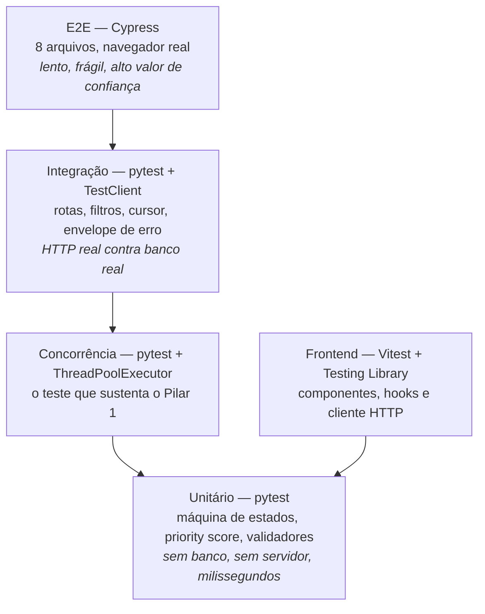

# Estratégia de Testes

Este documento define os níveis de teste do Logos, o que cada um cobre, como
executá-los, a mecânica do teste de concorrência e o que fica reservado para os
testes ponta a ponta.

## 1. A pirâmide aplicada

A pirâmide clássica — muitos testes unitários, alguns de integração, poucos
ponta a ponta — é seguida porque ela é a que dá **retorno por segundo de
execução**. No Logos, ela se traduz assim:



| Nível        | Ferramenta                    | Volume           | Tempo alvo              |
| ------------ | ----------------------------- | ---------------- | ----------------------- |
| Unitário     | pytest                        | Maioria          | Milissegundos por teste |
| Integração   | pytest + `TestClient`         | Moderado         | Décimos de segundo      |
| Concorrência | pytest + `ThreadPoolExecutor` | Alguns, marcados | Segundos                |
| Frontend     | Vitest + Testing Library      | Moderado         | Décimos de segundo      |
| E2E          | Cypress                       | 8 arquivos       | Minutos                 |

### 1.1 O desvio deliberado da pirâmide

O teste de concorrência não é unitário nem de integração: ele sobe a aplicação,
abre múltiplas conexões reais e dispara requisições simultâneas. Ele fica em um
diretório próprio (`tests/concurrency`) e tem marcador próprio, porque **é o
teste mais caro e o mais importante do projeto**. Ele prova a única garantia
que, se falhar em produção, custa dados.

## 2. Testes unitários — `tests/unit/`

Rodam sem banco, sem servidor e sem rede. São possíveis porque a camada
`domain/` é pura.

| Arquivo                   | O que cobre                                                                                                                                                                                                                              |
| ------------------------- | ---------------------------------------------------------------------------------------------------------------------------------------------------------------------------------------------------------------------------------------- |
| `test_rules.py`           | Todas as transições da máquina de estados: as válidas passam, as proibidas levantam `InvalidStatusTransition`. Inclui `FECHADO` como terminal e "reabrir" recusado.                                                                      |
| `test_rules.py`           | Exigência de `resolution_notes` em `FECHADO` e `INCONCLUSIVO`, incluindo o limite mínimo de 10 caracteres e a rejeição de string só com espaços.                                                                                         |
| `test_priority.py`        | Cálculo do score **por faixa**: acidente com vítimas sempre acima de bloqueio de pista; `ALTA` acima de `MEDIA` com mesma categoria; aging saturando no teto de 400; pressão de SLA somando 200 apenas dentro da janela de 60 minutos.   |
| `test_priority.py`        | `test_priority_score_orders_victims_accident_first`: garante a propriedade que dá sentido à fila — a ordem produzida é a ordem esperada pela operação.                                                                                   |
| `test_schemas.py`         | Validadores Pydantic: `title` sem HTML e com trim, faixa de latitude e longitude, normalização da placa para maiúsculas, rejeição de enum fora do contrato.                                                                              |
| `test_retry.py`           | Classificação de falha (transitória vs determinística), teto exponencial do backoff, jitter dentro do teto e não constante, `rollback` antes de cada espera e a política por tipo de operação (leitura, escrita condicional e `INSERT`). |
| `test_circuit_breaker.py` | Máquina de estados com relógio injetado: abre no limiar e não antes, sucesso zera a contagem, `Retry-After` nunca é zero, uma única sondagem após o cooldown, sonda bem-sucedida fecha e sonda que falha reabre sem esperar o limiar.    |
| `test_database_engine.py` | Trava a configuração que faz o disjuntor ter o que contar: `connect_timeout` finito no engine PostgreSQL, `pool_pre_ping` mantido, e nada disso vazando para o SQLite.                                                                   |
| `test_cache.py`           | Cache da listagem com relógio injetado: fresco dentro do TTL e vencido depois, TTL zero como modo "sempre revalidar", descarte das entradas mais antigas acima do teto e chave estável que não depende da ordem dos campos.              |

```bash
cd backend
pytest tests/unit -q
```

## 3. Testes de integração — `tests/integration/`

Exercitam a API real contra um banco real, via `TestClient` do FastAPI. O que
eles cobrem é o **contrato**, não a implementação: nenhum teste verifica nomes
de método interno.

| Arquivo                        | O que cobre                                                                                                                                                                                                                                                      |
| ------------------------------ | ---------------------------------------------------------------------------------------------------------------------------------------------------------------------------------------------------------------------------------------------------------------- |
| `test_incidents_crud.py`       | `POST` cria com `201`, `Location` e `ETag: "1"`; `GET` por id devolve o recurso completo; `DELETE` responde `204` e a leitura seguinte devolve `410`.                                                                                                            |
| `test_filters.py`              | Filtros combináveis: status múltiplo, criticidade múltipla, categoria múltipla, busca textual, intervalo de datas. Inclui o caso de combinação sem resultado.                                                                                                    |
| `test_pagination.py`           | Paginação por cursor: a primeira página não tem cursor de entrada; `nextCursor` avança e **não repete nem pula** itens; `hasNextPage` é coerente; cursor inválido devolve `400 INVALID_CURSOR`.                                                                  |
| `test_status_machine.py`       | Transição válida devolve `200`; transição proibida devolve `422 INVALID_STATUS_TRANSITION` com `details.allowed` correto; `FECHADO` sem `resolution_notes` devolve `422 RESOLUTION_NOTES_REQUIRED`.                                                              |
| `test_optimistic_lock.py`      | Versão correta avança e devolve `ETag` novo; versão defasada devolve `409 VERSION_CONFLICT` com `details.serverState` preenchido; `If-Match` malformado devolve `412`.                                                                                           |
| `test_idempotency.py`          | Mesma chave com mesmo corpo devolve a resposta original sem criar um segundo recurso; mesma chave com corpo diferente devolve `409 IDEMPOTENCY_KEY_REUSED`.                                                                                                      |
| `test_errors.py`               | O envelope de erro é idêntico em todos os códigos; `VALIDATION_ERROR` traz `details.fields`; nenhuma resposta de erro vaza _stack trace_.                                                                                                                        |
| `test_meta.py`                 | `GET /meta/enums` devolve exatamente as 5 categorias, 3 criticidades, 4 status e o mapa de transições.                                                                                                                                                           |
| `test_health.py`               | `GET /health/live` responde `200`; `GET /health/ready` responde `200` com o banco no ar e `503` quando ele está indisponível.                                                                                                                                    |
| `test_security.py`             | Cabeçalhos de segurança no sucesso e no erro; CORS libera só a origem configurada; `429` com `Retry-After`; health e preflight isentos de cota.                                                                                                                  |
| `test_retry_http.py`           | Falha transitória de banco: leitura repete e responde `200`; esgotadas as tentativas, `503` com `Retry-After`; escrita sem `Idempotency-Key` não repete; com a chave, repete; `POST` (`INSERT`) nunca repete; erro determinístico vira `500`.                    |
| `test_circuit_breaker_http.py` | Depois do limiar a API **para de chamar o banco** e responde `503` com `Retry-After`; passado o cooldown uma sondagem passa e o tráfego volta; `404` não abre o circuito; `/health/live` responde com o circuito aberto.                                         |
| `test_cache_http.py`           | `MISS` na primeira leitura e `HIT` na seguinte, sem tocar no banco; mutação esvazia o cache e o registro novo aparece; `REVALIDATED` no TTL vencido; `STALE` com o banco fora, devolvendo a cópia antiga; sem cópia, o `503` sobe.                               |
| `test_database_timeouts.py`    | **Só roda no PostgreSQL** (pulado no SQLite, que usa `PRAGMA busy_timeout`): a sessão recebe o `statement_timeout` configurado; a consulta que estoura é cancelada com SQLSTATE `57014` e conta como transitória; o `SET LOCAL` não vaza para a conexão do pool. |
| `test_timeline.py`             | Toda mudança de estado gera evento (`CREATED`, `STATUS_CHANGED`, `DELETED`) com origem, destino e autor; mudança **recusada** (`409`, `422`) não gera; a timeline sobrevive ao soft delete; id inexistente devolve `404` em vez de lista vazia.                  |

```bash
cd backend
pytest tests/integration -q
```

### 3.1 Por que integrar em vez de simular

O lock otimista, o envelope de erro e a paginação por cursor são comportamentos
que **existem na fronteira** entre app, banco e protocolo HTTP. Um teste com
repositório simulado verifica o mock, não o SQL. Como o SQL é justamente onde o
CAS vive, toda a garantia do Pilar 1 seria testada em um lugar onde ela não
existe.

## 4. Teste de concorrência — `tests/concurrency/`

É o teste que sustenta o Pilar 1. Ele não verifica que o código "parece
correto": ele provoca a corrida e verifica o resultado observável.

### 4.1 O que ele verifica

```python
import concurrent.futures as cf
import pytest

@pytest.mark.concurrency
def test_concurrent_status_update_returns_conflict(client, incident_factory):
    """Dez transições simultâneas sobre o mesmo incidente: uma vence.

    Com CAS feito em Python (SELECT + if + UPDATE), mais de uma
    requisição retornaria 200 e a última sobrescreveria as demais.
    Com o CAS no banco, exatamente uma linha é afetada e as outras
    nove recebem 409 com o estado atual.
    """
    incident = incident_factory(status="ABERTO", version=1)
    expected = incident["version"]

    def change_status(target: str) -> int:
        response = client.post(
            f"/api/v1/incidents/{incident['id']}/status",
            json={"status": target, "resolutionNotes": "Encerrado na corrida."},
            headers={"If-Match": f'"{expected}"'},
        )
        return response.status_code

    target = "FECHADO"
    with cf.ThreadPoolExecutor(max_workers=10) as pool:
        statuses = list(pool.map(lambda _: change_status(target), range(10)))

    assert statuses.count(200) == 1, "exatamente uma transição pode vencer"
    assert statuses.count(409) == 9, "as demais devem receber conflito"

    final = client.get(f"/api/v1/incidents/{incident['id']}").json()
    assert final["status"] == "FECHADO"
    assert final["version"] == expected + 1
    assert final["resolutionNotes"] == "Encerrado na corrida."
```

Três asserções, três garantias distintas:

| Asserção                   | Garantia                                                       |
| -------------------------- | -------------------------------------------------------------- |
| `statuses.count(200) == 1` | Ninguém foi sobrescrito em silêncio.                           |
| `statuses.count(409) == 9` | O conflito é **reportado**, não engolido.                      |
| `version == expected + 1`  | A versão avançou exatamente uma vez, mesmo com dez tentativas. |

### 4.2 Outros cenários do diretório

| Teste                                                                | O que prova                                                                                                                                                            |
| -------------------------------------------------------------------- | ---------------------------------------------------------------------------------------------------------------------------------------------------------------------- |
| `test_dez_threads_com_mesma_versao_tem_um_vencedor_e_nove_conflitos` | O núcleo do Pilar 1: dez threads com a mesma versão esperada produzem exatamente um `200` e nove `409`.                                                                |
| `test_corrida_com_expected_version_no_corpo`                         | A versão pode vir no corpo (`expectedVersion`) em vez do `If-Match`, e a proteção continua valendo.                                                                    |
| `test_vencedor_nao_e_sobrescrito_por_escrita_tardia`                 | A regressão Marina/Rafael: a nota de resolução de quem venceu não é apagada por quem escreveu depois com dados desatualizados.                                         |
| `test_requisicoes_simultaneas_com_a_mesma_chave_criam_um_so`         | Cinco requisições simultâneas com a mesma `Idempotency-Key` produzem um único recurso. Vive em `tests/integration/test_idempotency.py` porque precisa do cliente HTTP. |

```bash
cd backend
pytest tests/concurrency -v
python -m pytest -m concurrency
```

### 4.3 Por que o banco em memória é inaceitável aqui

`sqlite:///:memory:` parece a escolha óbvia para testes rápidos, e é
**exatamente a escolha que invalida este teste**. Três razões:

**1. Cada conexão teria o seu próprio banco.** Em SQLite, um banco
`:memory:` existe dentro da conexão que o criou. Duas conexões abertas em
paralelo veem **dois bancos diferentes**. As dez threads não estariam
disputando a mesma linha — estariam escrevendo em dez mundos isolados. O teste
passaria sempre, provando nada.

**2. A alternativa de contornar isso elimina o paralelismo.** A saída conhecida
é usar `file::memory:?cache=shared` com um `StaticPool` de uma única conexão.
Isso faz todas as threads compartilharem o mesmo banco — e serializa todas elas
naquela conexão única. Deixa de haver concorrência real: o teste mede a fila do
pool, não a corrida no `UPDATE`.

**3. O banco em memória não tem o comportamento que se quer medir.** Sem `WAL`,
sem `busy_timeout` e sem contenção real de escrita, o SQLite em memória esconde
justamente os fenômenos que o teste existe para provocar — bloqueio de escrita,
timeout e reavaliação do predicado sob concorrência.

### 4.4 O ambiente usado de fato

| Ambiente              | Quando é usado                                                                              | Configuração                                                                                                                                                                               |
| --------------------- | ------------------------------------------------------------------------------------------- | ------------------------------------------------------------------------------------------------------------------------------------------------------------------------------------------ |
| **PostgreSQL**        | Sempre que `DATABASE_URL` aponta para um Postgres (local via Podman ou o Neon de _staging_) | É o cenário de produção: MVCC real, isolamento real, contenção real.                                                                                                                       |
| **SQLite em arquivo** | Padrão quando não há Postgres disponível                                                    | Banco em arquivo temporário, `PRAGMA journal_mode=WAL` e `PRAGMA busy_timeout=5000`, para que a escrita concorrente seja serializada pelo banco em vez de falhar com `database is locked`. |

O banco é criado em arquivo temporário por sessão de teste e removido ao final.
Cada teste de concorrência recebe uma base limpa, o que evita que a ordem de
execução influencie o resultado.

A consequência honesta dessa escolha: **o SQLite é um substituto, não um
equivalente.** Por isso o CI roda a suíte de concorrência contra PostgreSQL
quando o serviço está disponível, e a diferença entre os dois ambientes é
registrada aqui em vez de escondida.

## 5. Testes de frontend — `frontend/src/test/`

Vitest com Testing Library, servidor de mock de API (MSW) e _factories_ de
incidentes.

| Alvo                   | O que é verificado                                                                                                                                       |
| ---------------------- | -------------------------------------------------------------------------------------------------------------------------------------------------------- |
| `CriticalityBadge`     | Renderiza cor, ícone, forma e rótulo. Com a classe de cor removida, ícone e texto continuam presentes (a regra de redundância de canais).                |
| `StatusBadge`          | Rótulo textual presente em todos os quatro status.                                                                                                       |
| `SlaTimer`             | Formata `mm:ss`, muda de faixa conforme o prazo e anuncia a mudança com `aria-live`.                                                                     |
| `PriorityPill`         | O tooltip mostra a decomposição do score termo a termo.                                                                                                  |
| `IncidentRow`          | Só re-renderiza quando `version` ou `priorityScore` mudam.                                                                                               |
| `useIncidents`         | Aplica filtros como query key; trocar de filtro reusa o cache quando a combinação já foi vista.                                                          |
| `useIncidentMutations` | `onMutate` aplica o otimista; `onError` com `409` faz rollback e abre o diálogo com o `serverState`.                                                     |
| `http.ts`              | Respeita o timeout com `AbortController`; não repete mutação sem `Idempotency-Key`; repete `GET` conforme a política; envia `If-Match` quando informado. |
| `ConflictDialog`       | Lista campo a campo o que o cliente tentou e o que está no servidor; não oferece ação de sobrescrever.                                                   |
| `FiltersBar`           | Escreve o estado dos filtros na URL e restaura a partir dela.                                                                                            |

```bash
pnpm --filter web test          # modo watch
pnpm --filter web test:run      # execução única, usada na CI
```

A cobertura do frontend ainda **não é coletada**: não existe script de cobertura
em `frontend/package.json`. O portão de 80% vale para o backend (ver
[seção 7](#7-cobertura)) e a cobertura do frontend está planejada na issue
**#60** (`ci: adiciona cobertura, badge e checagem de bundle`, milestone
`M4 — Qualidade`).

## 6. Testes ponta a ponta — `frontend/cypress/`

**Cypress**, com oito arquivos. E2E é caro, lento e frágil; ele só se paga
quando cobre um caminho que, se quebrar, quebra o produto inteiro — e quando o
que ele prova **não pode** ser provado por baixo: o `jsdom` não avalia CSS, não
rola a lista virtualizada e não navega; o teste de concorrência fala com o
repositório, não com a tela.

| Arquivo               | O que prova                                                                                                                                                  |
| --------------------- | ------------------------------------------------------------------------------------------------------------------------------------------------------------ |
| `login.cy.ts`         | Credencial de demonstração já preenchida, rótulos ligados aos campos, erro de credencial anunciado como região viva e entrada na triagem                     |
| `triagem.cy.ts`       | Ordem da fila pelo score, virtualização, filtro por criticidade + URL recarregável, KPI de status, busca por código, `j`/`k`/`Enter`/`Esc` e tema persistido |
| `cadastro.cy.ts`      | Validação que barra o envio incompleto (com foco no primeiro campo) e o registro que entra na fila já priorizado                                             |
| `ciclo-de-vida.cy.ts` | Transições permitidas, justificativa obrigatória de 10 caracteres, `FECHADO` terminal e o evento gravado na auditoria                                        |
| `conflito.cy.ts`      | **O Pilar 1 no navegador**: a versão muda por fora, a tentativa pela tela recebe `409` e o diff aparece campo a campo                                        |
| `guia.cy.ts`          | Guia na primeira visita, os oito passos, o passo do cadastro sem prender o foco (#146) e o botão **Guia** reabrindo                                          |
| `contas.cy.ts`        | `ADMIN` convida e vê o convite pendente; `REPORTER` não alcança a tela **nem pela API**; a fila do repórter é só o que ele abriu                             |
| `sessao.cy.ts`        | Logoff que revoga o token de verdade e `401` que devolve à tela de login avisando que a sessão expirou                                                       |

### 6.1 Como a suíte se sustenta

- **Um comando, três serviços na ordem certa.** `pnpm e2e` (raiz) chama
  `scripts/e2e.mjs`, que cria um SQLite descartável (`backend/e2e.db`), roda
  `alembic upgrade head`, popula com o seed, sobe a API, **compila** o front
  (`vite build` + `vite preview`) e só então chama o Cypress. O artefato testado
  é o mesmo que vai ao ar — não o servidor de desenvolvimento.
- **Limite de requisições desligado nesse ambiente.** O teto de 20 escritas por
  minuto existe para proteger a operação; deixá-lo ligado aqui reprovaria testes
  por um comportamento correto do produto. Ele continua ligado na API publicada,
  e o teste unitário do limitador cobre a regra.
- **Preparação pela API, verificação pela tela.** `cy.request` cria o incidente
  do cenário e, no teste do conflito, muda a versão **sem passar pela interface**
  — é a única forma de reproduzir dois navegadores com a mesma versão em cache.
- **`cy.session` para o login.** O token vive em `sessionStorage`; o comando
  guarda a sessão (e a marca de "guia já visto") e a devolve pronta. Specs que
  **encerram** a sessão usam um `sessionId` próprio para não invalidar o cache
  dos outros.
- **Artefatos na falha.** Vídeo e print saem do próprio runner e o job da CI os
  publica como artefato quando o teste falha.

### 6.2 O que fica de fora do E2E, e por quê

| Fora do E2E                         | Onde é coberto                                                                    |
| ----------------------------------- | --------------------------------------------------------------------------------- |
| Todas as combinações de filtro      | Testes de integração da API.                                                      |
| Estados de loading, erro e offline  | Testes de componente com MSW, controlando a resposta.                             |
| Corrida de status com threads       | `tests/concurrency` — E2E não consegue produzir simultaneidade confiável.         |
| Paginação por cursor completa       | Integração da API; o E2E só confirma que a lista carrega.                         |
| Primeiro acesso (troca obrigatória) | Componente + integração: exigiria ler a senha temporária do log do servidor.      |
| Mensagens e códigos de erro da API  | Unitários e de integração; o E2E cobre a credencial inválida, que é o que aparece |

Colocar qualquer um desses no E2E aumentaria o tempo de execução e a taxa de
falha intermitente sem aumentar a confiança no produto.

## 7. Cobertura

```toml
# backend/pyproject.toml (trecho)
[tool.pytest.ini_options]
addopts = "-q --strict-markers --cov=app --cov-report=term-missing --cov-fail-under=80"
testpaths = ["tests"]
markers = ["concurrency: testes de corrida com threads"]
```

| Regra                       | Valor                                                                                                                                        |
| --------------------------- | -------------------------------------------------------------------------------------------------------------------------------------------- |
| Cobertura mínima do backend | **80%** (falha o build abaixo disso)                                                                                                         |
| `--strict-markers`          | Marcador não declarado é erro, não aviso — evita teste que "não roda" sem ninguém notar                                                      |
| Cobertura do frontend       | Ainda **não coletada** — não existe script de cobertura em `frontend/package.json`; planejada na issue #60, sem portão definido por enquanto |
| Meta qualitativa            | 100% das transições da máquina de estados e 100% dos códigos do catálogo de erro cobertos                                                    |

### 7.1 Cobertura não é meta, é piso

80% não significa que 20% do código pode estar errado. Significa que um número
abaixo disso indica que uma área inteira ficou sem teste. O que importa não é o
percentual, e sim as asserções: um teste que chama a rota e verifica apenas
`status_code == 200` conta para a cobertura e não prova nada.

As áreas que **precisam** estar cobertas independentemente do percentual geral:

- Todas as transições de `rules.py`, válidas e proibidas.
- O caminho `rowcount == 0` do CAS — é o `else` que ninguém testa e que decide
  se o sistema corrompe dados.
- Os quatro cenários de `Idempotency-Key`.
- Os dois estados do healthcheck (`ready` com e sem banco).

## 8. Comandos de referência

```bash
# Backend
cd backend
pytest -q                       # suíte completa, com cobertura
pytest tests/unit -q            # apenas unitários
pytest tests/integration -q     # apenas integração
pytest tests/concurrency -v     # apenas corrida
pytest -m concurrency           # por marcador
pytest --cov-report=html        # relatório navegável em htmlcov/

# Frontend
pnpm --filter web test          # watch
pnpm --filter web test:run      # execução única
# Cobertura do frontend: ainda não coletada (planejada na issue #60)

# Ponta a ponta (navegador real, Cypress)
pnpm e2e                        # banco descartável + API + front compilado + Cypress
pnpm e2e --spec conflito        # um arquivo só
pnpm --filter web e2e:open      # modo interativo, com a aplicação já no ar

# Tudo (o que a CI roda)
pnpm verify
```

## 9. Convenções

| Convenção     | Regra                                                                                                           |
| ------------- | --------------------------------------------------------------------------------------------------------------- |
| Nome de teste | Descreve o comportamento observável: `test_concurrent_status_update_returns_conflict`, e não `test_update_2`.   |
| Estrutura     | Dado / quando / então, com comentário apenas onde a intenção não é óbvia pelo código.                           |
| Dados         | Sempre por _factory_. Nenhum teste depende de outro nem da ordem de execução.                                   |
| Banco         | Criado e destruído por teste, em arquivo temporário ou Postgres.                                                |
| Tempo         | Nenhum teste depende de `sleep` para sincronizar.                                                               |
| Mocks         | Só na fronteira externa (tempo, rede de terceiros). Não se simula o próprio repositório em teste de integração. |
