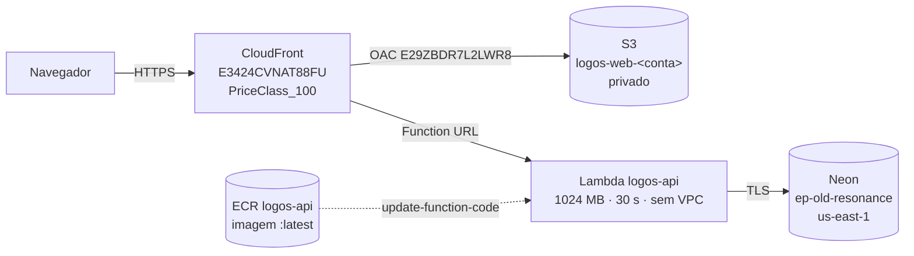
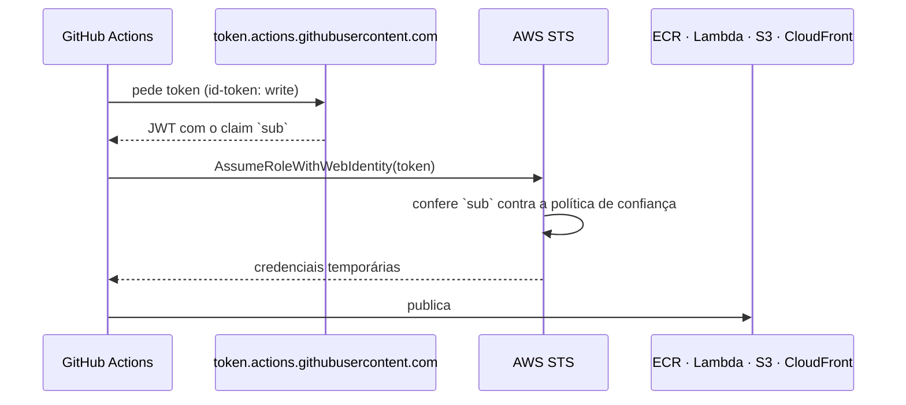

# Deploy na AWS

Como o Logos é publicado, quanto custa e o que quebra no caminho.

A decisão está no [ADR 0017](adr/0017-lambda-s3-cloudfront.md). Este documento é
o **como**: os recursos, os números medidos, a automação e os limites conhecidos.

> **Sobre identificadores neste documento.** O repositório é público. Onde o
> identificador da conta apareceria — ARNs, nomes de bucket —, ele está como
> `<conta>`. O que é público de fato (o domínio do CloudFront e a URL da função)
> aparece literal, porque já é o que o navegador chama.

---

## 1. O que está no ar



| Recurso       | Identificador                        | Configuração                                              |
| ------------- | ------------------------------------ | --------------------------------------------------------- |
| CloudFront    | `E3424CVNAT88FU`                     | `PriceClass_100`, OAC `E29ZBDR7L2LWR8`, invalidação no deploy |
| S3            | `logos-web-<conta>`                  | Privado; a política só permite leitura por esta distribuição |
| Lambda        | `logos-api`                          | Imagem, 1.024 MB, timeout 30 s, x86_64, **sem VPC**       |
| Function URL  | `…lambda-url.us-east-1.on.aws`       | `AuthType: NONE`, `InvokeMode: BUFFERED`                  |
| ECR           | `logos-api`                          | Tag `latest` + política de ciclo de vida                  |
| CloudWatch    | `/aws/lambda/logos-api`              | Retenção de **14 dias**                                   |
| Região        | `us-east-1`                          | —                                                         |

### Endereços públicos

| O quê      | URL                                                                  |
| ---------- | -------------------------------------------------------------------- |
| Aplicação  | https://debpv51kciojx.cloudfront.net                                 |
| API        | https://c33z3s4di7cywi7azqthdd62mu0ufnds.lambda-url.us-east-1.on.aws |
| Saúde      | `…/api/v1/health/ready`                                              |

---

## 2. Quanto custa

**US$ 0,023 por mês.** Um item cobrado.

| Serviço       | Cobrado? | Por quê                                                                 |
| ------------- | -------- | ----------------------------------------------------------------------- |
| **ECR**       | **Sim**  | 0,228 GB × US$ 0,10/GB-mês = **US$ 0,0228** — a imagem é o único gasto. |
| Lambda        | Não      | 1 M de requisições e 400.000 GB-s por mês na faixa *Always Free*.       |
| CloudFront    | Não      | 1 TB de tráfego e 10 M de requisições na faixa *Always Free*.           |
| S3            | Não      | O bucket tem alguns MB; US$ 0,023/GB não chega a um centavo.            |
| CloudWatch    | Não      | Dentro da faixa gratuita de ingestão.                                   |
| GitHub Actions| Não      | Gratuito e ilimitado em repositório público.                            |

### O que **não** existe na conta, e por quê

| Recurso          | Custo evitado   | Como foi evitado                                          |
| ---------------- | --------------- | --------------------------------------------------------- |
| **NAT Gateway**  | US$ 32,85/mês   | A Lambda roda **fora de VPC** — sem VPC, não há NAT.        |
| **RDS**          | ~US$ 15/mês     | O banco é o Neon, que já existia.                          |
| **ALB**          | ~US$ 16/mês     | A Function URL faz o papel de ponto de entrada.            |
| **EC2**          | ~US$ 8/mês      | Lambda escala a zero; não há instância ligada.             |
| **Secrets Manager** | US$ 0,40/segredo | As variáveis vão direto na configuração da função.     |

O NAT Gateway sozinho custaria **1.400 vezes** o gasto mensal atual. Ele só seria
necessário se a função entrasse em VPC para alcançar um banco dentro da AWS — e é
por isso que a decisão de manter o Neon é a decisão central do ADR.

### Proteção contra a estimativa estar errada

Orçamento na conta em **US$ 5**, com alerta por e-mail em gasto **real** e em
**previsão**. Se o custo fugir do previsto, o aviso chega antes da fatura.

---

## 3. Automação: deploy por OIDC, sem segredo no repositório

Cada merge na `main` dispara o `.github/workflows/deploy-aws.yml`, que publica os
dois lados. **Nenhuma credencial AWS de longa duração existe no repositório.**

### Como a confiança funciona



A política de confiança da role `logos-github-deploy` exige:

```
token.actions.githubusercontent.com:aud = sts.amazonaws.com
token.actions.githubusercontent.com:sub LIKE repo:Alysson-Araujo*/logos*:ref:refs/heads/main
```

**O curinga no meio é deliberado, e não descuido.** O GitHub passou a emitir o
claim `sub` com os IDs de dono e repositório embutidos
(`repo:Dono@123/Repo@456:…`), o que quebrou o casamento literal. O curinga cobre
os dois formatos — e **o `ref:refs/heads/main` continua obrigatório**, então um
pull request de fork não assume a role.

### O que o workflow faz

| Job        | Ação                                                                             |
| ---------- | -------------------------------------------------------------------------------- |
| `portao`   | Espera a CI do **mesmo commit** ficar verde antes de publicar.                    |
| `front`    | Build do Vite → `s3 sync --delete` → invalidação `/*` no CloudFront.              |
| `api`      | Build da imagem → push no ECR → `update-function-code` → espera → smoke test.     |
| `aviso-de-falha` | Em falha, abre uma issue (e reaproveita a aberta, comentando o commit novo). |

O `aviso-de-falha` existe por um motivo concreto: **o deploy já falhou quatro
vezes seguidas sem ninguém ver.** Os checks do PR ficam verdes (a CI é outro
workflow), o merge acontece, e o deploy morre depois. Um erro que não tem onde
aparecer não é um erro — é um silêncio.

### Permissões da role

A role concede **só o necessário**, e nada além:

- `ecr:*` restrito ao repositório `logos-api`
- `lambda:UpdateFunctionCode` e `lambda:GetFunction*` na função `logos-api`
- `s3:*` restrito ao bucket `logos-web-<conta>`
- `cloudfront:CreateInvalidation` na distribuição `E3424CVNAT88FU`

---

## 4. Publicar à mão (quando a automação não serve)

```bash
# 1. Front
cd frontend
VITE_API_BASE_URL="https://<id>.lambda-url.us-east-1.on.aws/api/v1" pnpm build
aws s3 sync dist/ "s3://logos-web-<conta>/" --delete
aws cloudfront create-invalidation --distribution-id E3424CVNAT88FU --paths "/*"

# 2. API — a base da imagem NÃO é escolha livre (ver §5)
cd ../backend
aws ecr get-login-password --region us-east-1 \
  | docker login --username AWS --password-stdin "<conta>.dkr.ecr.us-east-1.amazonaws.com"
docker build --platform linux/amd64 -f Dockerfile.lambda -t "<conta>.dkr.ecr.us-east-1.amazonaws.com/logos-api:latest" .
docker push "<conta>.dkr.ecr.us-east-1.amazonaws.com/logos-api:latest"

# 3. Apontar a função e esperar
aws lambda update-function-code --function-name logos-api \
  --image-uri "<conta>.dkr.ecr.us-east-1.amazonaws.com/logos-api:latest"
aws lambda wait function-updated --function-name logos-api
```

### Voltar atrás

A política de ciclo de vida do ECR mantém a imagem anterior por **7 dias** (a
regra remove o que ficou sem tag), e `latest` é imune às duas regras por
construção. Então o retorno é um comando:

```bash
aws lambda update-function-code --function-name logos-api --image-uri "<conta>.dkr.ecr.us-east-1.amazonaws.com/logos-api@<digest-anterior>"
```

O digest anterior está no histórico do CloudWatch ou na saída do último deploy.

---

## 5. O que quebra, e por quê

Os cinco problemas abaixo custaram tempo real. Estão aqui para não custarem de
novo. O relato completo, com mais treze erros de outras áreas, está em
`ERROS-E-SOLUCOES-LOGOS.md`.

### 5.1 A função não sobe: `SMTP_HOST` obrigatório

**Sintoma.** A Lambda falha na inicialização com
`ValidationError: SMTP_HOST é obrigatório em produção`.

**Causa.** A configuração exige SMTP em produção **ou** `EMAIL_DISABLED=true`.

**Correção.** `EMAIL_DISABLED=true` nas variáveis da função.

### 5.2 A Function URL devolve 403 e o `invoke` devolve 200

**Sintoma.** `aws lambda invoke` responde 200; HTTP real na Function URL responde
**403** com `x-amzn-ErrorType: AccessDeniedException`.

**Causa.** Desde outubro de 2025, Function URLs novas exigem **duas** permissões:
`lambda:InvokeFunctionUrl` **e** `lambda:InvokeFunction`. Criar a URL só adiciona
a primeira.

**Correção.**

```bash
aws lambda add-permission --function-name logos-api \
  --statement-id UrlPolicyInvokeFunction \
  --action lambda:InvokeFunction --principal "*"
```

**O que ficou aprendido.** Três verificações passaram e a quarta falhou — e eu
confiei nas três. Quando dois caminhos levam ao mesmo recurso e divergem, o que
funciona **não absolve** o que não funciona: o teste tem que exercitar o caminho
que o usuário usa.

### 5.3 A imagem constrói e a função nunca inicia

**Sintoma.** Imagem sobre `python:3.12-slim` publica sem erro; a função não sobe.

**Causa.** O runtime de imagem da Lambda precisa do `aws-lambda-ric`, que só
existe na base oficial.

**Correção.** `FROM public.ecr.aws/lambda/python:3.12`.

**O que ficou aprendido.** Build passar não diz nada sobre o artefato rodar.
Publicar imagem que nunca sobe é pior que falhar no build: o erro sai do lugar
onde dá para vê-lo.

### 5.4 O deploy falha com `Not authorized to perform sts:AssumeRoleWithWebIdentity`

Ver §3. É o claim `sub` que mudou de formato. O sintoma não diz **qual** campo
falhou — por isso a política de confiança está transcrita aqui, e não só no
console da AWS.

### 5.5 O banco recusa a conexão: `statement_timeout`

**Sintoma.** `ERROR: unsupported startup parameter in options: statement_timeout`.

**Causa.** O endpoint com `-pooler` do Neon (PgBouncer) não aceita o parâmetro de
_startup_ que o driver envia.

**Correção.** Usar o endpoint **direto**, sem `-pooler`. Documentado também em
[`08-deploy.md`](08-deploy.md) §3.3.

---

## 6. Limites conhecidos

Declarados, e não escondidos — um limite não declarado é um defeito.

| Limite                              | Impacto                                                                    |
| ----------------------------------- | -------------------------------------------------------------------------- |
| **SSE não funciona em produção**    | A Function URL é `BUFFERED`; `GET /incidents/stream` só roda local.         |
| Cold start de 1,5 a 2,5 s           | Primeira invocação de cada ambiente. Mitigável com aquecimento agendado.    |
| Uma requisição por ambiente         | Sem estado em processo. O rate limit não pode ser em memória.               |
| `/tmp` é o único disco              | Nada que precise persistir entre invocações.                                |
| 15 minutos de execução máxima       | Irrelevante para esta aplicação.                                            |
| Imagem só na base da AWS            | Ver §5.3.                                                                   |
| Retenção de log de 14 dias          | Histórico curto por escolha; reduz custo e é suficiente para depurar.       |

---

## 7. Verificação pós-deploy

```bash
# A API responde e o banco está acessível?
curl -fsS "https://<id>.lambda-url.us-east-1.on.aws/api/v1/health/ready"
# → {"status":"ready","database":"ok"}

# A autenticação está de pé? (401 sem token é a resposta certa)
curl -s -o /dev/null -w "%{http_code}\n" "https://<id>.lambda-url.us-east-1.on.aws/api/v1/vehicles"
# → 401

# O front está na versão nova?
curl -fsS https://debpv51kciojx.cloudfront.net/ | grep -o 'index-[A-Za-z0-9_-]*\.js'
# → compare com o bundle do último build
```

**Verificar o efeito, não a declaração.** Já houve um caso em que a configuração
estava correta, o check estava verde e o ar estava três commits atrás.
